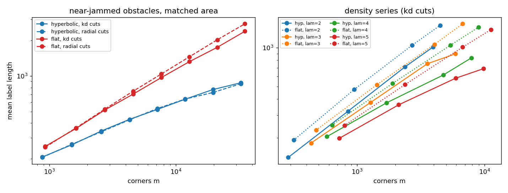

# Exact two-point labels among obstacles: hyperbolic versus flat discs

Prototype for `notes/hyperbolic.md` section 7 (step 2). Script `bench/hyperbolic_exact.py` (`run`, then `report`), raw data
`results/hyperbolic_exact.json`, figure `results/hyperbolic_exact.png`. Tables between the markers are regenerated by `report`.

## Conclusion (19 Oct 2026)

**The candidate theorem holds up in the prototype.**

Setup: near-jammed random geodesic triangles (circumradius 0.15, about 6 obstacles and 18 corners per unit area),
hyperbolic discs of radius R = 3 to 6.5 against flat discs of the same area. m runs from 900 to 33,000 corners. There
are 3 seeds per size up to R = 5.5.

**Exactness.**
- Every answer matches Dijkstra to 7e-16 relative error, both corner to corner and between random free points
  answered through their visible corners.
- The independent visibility check (Cyrus–Beck clipping) found 0 mismatches.

**Hyperbolic labels grow like R².**
- The mean label length is **21·R² within ±5%** over the whole range: 20.8–23.0 per R², kd cuts.
- The top separator stays at 21–25 corners per unit of cut length. That is the bounded crossing density κ the proof
  needs, so a cut of length 2R costs O(R).
- In terms of m: a + b·log² m fits within 2.5–3.1%, against 6–7% for a + b·√m.

**Flat labels grow like √m.**
- √m fits within 2.5–3.9%, against 15–18% for log² m.
- The free exponent is 0.61–0.66, against 0.40 for hyperbolic.
- label/√m creeps up from 8.4 to 12.7, as in the H2H study. There, min-degree elimination was the reason; here it
  is probably the lower-order levels.

**The gap grows with R, not with m.**
- Flat over hyperbolic (kd cuts): 1.23 at R = 3, 1.50 at R = 4, 1.86 at R = 5, 2.27 at R = 6, **2.72 at R = 6.5**.
- That matches the H2H study at the same R (2.4 at R = 6, 3.4 at R = 7) even though the corner density here is about
  20× higher.
- So the contrast is set by the radius in curvature units, as the area argument says.
- Index size at R = 6.5: 229 MB hyperbolic against 669 MB flat (float64 entries).

**The density threshold is there.**
- The heuristic is that the mean number of visible corners is finite in H² only when λ·w > 1, where w = 0.248 is the
  mean obstacle width. Flat geometry has no threshold.
- λ·w = 0.5:
  - A free point in H² sees 48, 99, 155, 165 corners at R = 3, 4, 5, 5.5. The flat disc stays at 62–86.
  - Hyperbolic label/R² rises 16 → 33.
  - The flat/hyperbolic ratio stops growing and stays at 1.47.
- λ·w = 1.24: points see 27–33 corners at every R, label/R² stays at 22–23, and the ratio grows 1.26 → 2.00.
- λ·w ≈ 0.74 and 0.99 sit in between: visibility creeps up at R = 5.5.

**What the data do not show.**
- R ≤ 6.5 is short: log² m and m^0.4 cannot be separated over 1.6 decades of m. The evidence is the flat
  label/R² and κ, not the fit.
- The bounded-visibility assumption (V) fails even at jamming. The longest edge grows 4.1 → 7.7, about like log m, as
  predicted for random obstacles. Mean visibility and κ stay bounded, so the theorem needs its expected-case form
  (notes/hyperbolic.md 7.4).
- The density series has a single seed per point. The threshold location (λ·w ≈ 1) is consistent with the heuristic,
  but not measured precisely.
- One obstacle shape and size.
- Query times (1.5–8 ms) are dominated by the Python visibility sweep for the two query points. They say nothing about
  a real implementation.
- Radial and kd cuts give nearly the same labels in H². In a disc the kd median lines are close to diameters, so the
  radial construction of the proof is not needed in practice.

## Main series: label length

<!-- BEGIN main -->
| R | hyperbolic m | label radial | label kd | top sep. / cut length | flat m | flat label radial | flat label kd | flat top sep. / cut length | flat / hyp (kd) |
|---:|---:|---:|---:|---:|---:|---:|---:|---:|---:|
| 3 | 877 | 206 ± 2 | 207 ± 3 | 21.4 | 927 | 251 ± 7 | 255 ± 5 | 18.4 | 1.23 |
| 3.5 | 1,498 | 265 ± 8 | 262 ± 4 | 20.1 | 1,622 | 365 ± 10 | 361 ± 7 | 18.0 | 1.38 |
| 4 | 2,573 | 339 ± 4 | 344 ± 4 | 21.3 | 2,737 | 525 ± 11 | 516 ± 8 | 19.0 | 1.50 |
| 4.5 | 4,308 | 428 ± 10 | 431 ± 19 | 21.7 | 4,605 | 746 ± 11 | 705 ± 14 | 18.8 | 1.64 |
| 5 | 7,134 | 532 ± 3 | 523 ± 16 | 22.1 | 7,671 | 1041 ± 9 | 971 ± 11 | 19.0 | 1.86 |
| 5.5 | 11,842 | 640 ± 3 | 638 ± 6 | 23.1 | 12,792 | 1454 ± 3 | 1323 ± 23 | 19.2 | 2.08 |
| 6 | 19,647 | 726 ± 0 | 769 ± 0 | 24.6 | 21,210 | 2022 ± 0 | 1746 ± 0 | 18.7 | 2.27 |
| 6.5 | 32,649 | 862 ± 0 | 877 ± 0 | 22.7 | 35,091 | 2755 ± 0 | 2384 ± 0 | 19.7 | 2.72 |
<!-- END main -->

## Fits

<!-- BEGIN fits -->
| series | label | fit a + b log^2 m | fit a + b sqrt m | free exponent in m |
|---|---|---:|---:|---:|
| hyperbolic | radial | 2.5% | 6.7% | 0.40 |
| hyperbolic | kd | 3.1% | 6.2% | 0.41 |
| flat | radial | 17.5% | 3.9% | 0.66 |
| flat | kd | 15.0% | 2.5% | 0.61 |
<!-- END fits -->

## Visibility and exactness

<!-- BEGIN visibility -->
| geometry | R | lam_real | mean degree of G | visible corners (mean / max) | longest edge | free point sees (mean / max) | exact (max rel. err.) | visibility check |
|---|---:|---:|---:|---:|---:|---:|---:|---:|
| hyperbolic | 3 | 5.99 | 20.1 | 27.9 / 62 | 4.13 | 19.1 / 42 | 3.5e-16 | 0/299 |
| hyperbolic | 3.5 | 5.96 | 21.2 | 29.7 / 69 | 4.93 | 23.4 / 49 | 3.2e-16 |  |
| hyperbolic | 4 | 6.09 | 20.7 | 28.7 / 70 | 5.66 | 27.5 / 53 | 3.3e-16 |  |
| hyperbolic | 4.5 | 6.04 | 21.3 | 29.5 / 82 | 6.14 | 26.9 / 46 | 4.2e-16 |  |
| hyperbolic | 5 | 6.02 | 21.0 | 29.3 / 74 | 7.58 | 25.3 / 47 | 4.0e-16 |  |
| hyperbolic | 5.5 | 6.04 | 21.2 | 29.5 / 76 | 6.04 | 25.7 / 44 | 4.4e-16 |  |
| hyperbolic | 6 | 6.04 | 21.1 | 29.4 / 85 | 6.94 | 22.7 / 49 | 4.1e-16 |  |
| hyperbolic | 6.5 | 6.07 | 21.2 | 29.5 / 79 | 7.66 | 24.1 / 55 | 4.4e-16 |  |
| flat | 3 | 5.83 | 21.2 | 29.9 / 53 | 4.46 | 27.7 / 40 | 4.2e-16 |  |
| flat | 3.5 | 5.86 | 21.8 | 30.7 / 52 | 4.98 | 25.5 / 42 | 3.7e-16 |  |
| flat | 4 | 5.75 | 22.3 | 31.7 / 58 | 5.42 | 27.1 / 42 | 4.5e-16 |  |
| flat | 4.5 | 5.72 | 22.9 | 32.4 / 56 | 5.94 | 29.0 / 39 | 6.3e-16 |  |
| flat | 5 | 5.72 | 23.2 | 32.8 / 61 | 6.28 | 27.3 / 51 | 5.1e-16 |  |
| flat | 5.5 | 5.67 | 23.7 | 33.5 / 65 | 6.55 | 29.2 / 47 | 5.8e-16 |  |
| flat | 6 | 5.69 | 23.7 | 33.6 / 63 | 6.80 | 31.2 / 57 | 7.1e-16 |  |
| flat | 6.5 | 5.68 | 23.8 | 33.8 / 62 | 7.60 | 29.6 / 42 | 6.9e-16 |  |
<!-- END visibility -->

## Density series

<!-- BEGIN density -->
| lam_eff | lam_eff x width | R | hyp m | hyp label kd | hyp longest edge | hyp point sees | flat m | flat label kd | flat longest edge | flat / hyp |
|---:|---:|---:|---:|---:|---:|---:|---:|---:|---:|---:|
| 2 | 0.50 | 3 | 288 | 142 | 5.55 | 47.9 | 318 | 193 | 8.10 | 1.36 |
| 2 | 0.50 | 4 | 849 | 323 | 7.63 | 98.7 | 951 | 476 | 12.88 | 1.47 |
| 2 | 0.50 | 5 | 2,370 | 710 | 9.87 | 155.0 | 2,691 | 1043 | 20.30 | 1.47 |
| 2 | 0.50 | 5.5 | 3,933 | 1011 | 10.70 | 164.9 | 4,488 | 1492 | 23.35 | 1.47 |
| 3 | 0.74 | 3 | 435 | 183 | 5.75 | 47.6 | 477 | 230 | 7.80 | 1.26 |
| 3 | 0.74 | 4 | 1,272 | 377 | 7.74 | 60.5 | 1,428 | 517 | 12.09 | 1.37 |
| 3 | 0.74 | 5 | 3,555 | 752 | 9.65 | 63.9 | 4,038 | 1061 | 12.78 | 1.41 |
| 3 | 0.74 | 5.5 | 5,898 | 897 | 10.77 | 68.4 | 6,732 | 1531 | 13.16 | 1.71 |
| 4 | 0.99 | 3 | 579 | 205 | 5.55 | 36.2 | 636 | 252 | 6.30 | 1.23 |
| 4 | 0.99 | 4 | 1,698 | 374 | 7.76 | 31.1 | 1,902 | 530 | 8.49 | 1.42 |
| 4 | 0.99 | 5 | 4,740 | 615 | 9.26 | 39.5 | 5,385 | 1045 | 9.74 | 1.70 |
| 4 | 0.99 | 5.5 | 7,866 | 834 | 10.36 | 51.2 | 8,973 | 1441 | 11.56 | 1.73 |
| 5 | 1.24 | 3 | 723 | 199 | 5.72 | 27.4 | 795 | 250 | 4.81 | 1.26 |
| 5 | 1.24 | 4 | 2,121 | 362 | 7.40 | 33.2 | 2,379 | 519 | 5.83 | 1.44 |
| 5 | 1.24 | 5 | 5,925 | 581 | 7.71 | 31.4 | 6,729 | 1010 | 7.36 | 1.74 |
| 5 | 1.24 | 5.5 | 9,831 | 689 | 8.56 | 33.4 | 11,217 | 1381 | 7.74 | 2.00 |
<!-- END density -->
