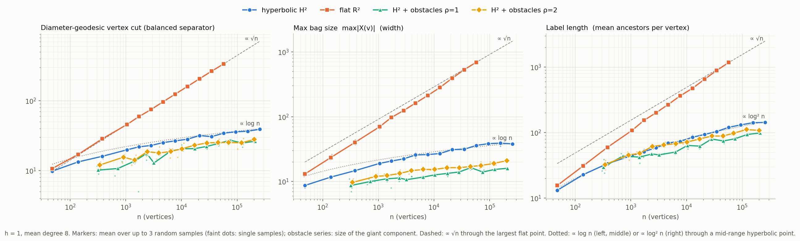

# H2H label growth on hyperbolic versus flat discs

Empirical check for the side project in `notes/hyperbolic.md`: do balanced separators, and hence H2H
labels, grow like $\log n$ / $\log^2 n$ on a hyperbolic disc and like $\sqrt n$ on a flat one? Script
`bench/hyperbolic_h2h.py` (`run`, then `report`), raw data `results/hyperbolic_h2h.json`, figure
`results/hyperbolic_h2h.png`. Everything uses the existing `H2HIndex` (`rgeo/oracles/h2h.py`, min-degree
elimination in `rgeo/oracles/tree_decomposition.py`) unchanged. The tables between the `<!-- BEGIN -->`
markers are regenerated by `report`; the prose is hand-written.



## Conclusion

**The effect is there, and it is large, from hyperbolic radius R of about 5 to 6 (n of a few hundred to a thousand).**
Over R = 5 to 11.5 (n from 380 to 257 000, spacing h = 1, mean degree 8):

| quantity | hyperbolic H² | flat R² | at n = 57 000 (R = 10), hyp vs flat |
|---|---|---|---|
| diameter-geodesic vertex cut (a balanced separator, independent of any elimination order) | 3.2–3.5 · R; fits $\log n$ to 2.2%, $\sqrt n$ only to 8.4% | 1.41 · √n (fits to 0.6%) | 34 vs 337 (9.8×) |
| max bag (H2H width) | 2.9–3.65 · R; fits $\log n$ to 3.6%, $\sqrt n$ to 10.4% | 2.0–2.9 · √n | 36 vs 689 (19×) |
| mean ancestors per vertex (label length) | 1.08–1.35 · R²; fits $\log^2 n$ to 2.7%, $\sqrt n$ to 14.7%; free exponent in $(\log n)^\beta$: β = 2.09 | 3.1–4.9 · √n; fits $\sqrt n$ to 7.2%, $\log^2 n$ only to 38.8% | 120 vs 1169 (9.7×) |
| total label entries | 6.8 M at n = 57k, 36.7 M at n = 257k | 66.5 M at n = 57k (n = 94k did not fit the memory budget) | 9.8× |

(Relative RMS errors of two-parameter fits $y = a + b f(n)$ over n ≥ 500.) The hyperbolic constants stay flat while n
grows by 2.8 decades (cut/R, bag/R, label/R² in the normalised table below); the flat label/√n creeps upward
(3.1 to 4.9), because min-degree elimination is not optimal on grid-like graphs, so the flat label curve has a
free exponent of 0.59, not 0.5, and the flat contrast in the label and bag rows is somewhat inflated by the heuristic.
The separator row is the clean one: it is a geometric cut, not a heuristic (hyperbolic ≈ 3.4 R, flat ≈ 1.41 √n).

**With obstacles the logarithmic behaviour survives.** Hyperbolic discs with 20% nominal area covered by
obstacles of radius 1 or 2 (13.5% / 10% of the points removed, 29% / 18% of the edges dropped; 27 to 18 000 obstacles
for ρ = 1 and 5 to 3600 for ρ = 2 between R = 5 and 11.5) give a *smaller* cut and width than the obstacle-free disc (cut
1.7–2.7 · R, max bag 1.3–2.0 · R) and a label length of 0.7–1.3 · R². Free power-law exponents are 0.16 (label) and
0.09 (bag) for both radii, against 0.59 and 0.57 flat. The tree height is the one quantity that gets worse:
1.3–1.4× the plain disc for ρ = 2 (300 vs 221 at R = 11.5), but it stays around 2.3 · R², not growing faster.
For the ρ = 1 series the fits cannot tell $\log^2 n$ from $\sqrt n$ (label: 7.3% vs 8.6% RMS), the curve is too flat and noisy; the evidence
there is the small exponent and the bounded ratios, not the fit.

**Where it departs.** At matched n the flat/hyperbolic ratio of the mean label length is 1.2 at R = 3 (n = 48),
1.4 at R = 4 (n = 139), 1.8 at R = 5 (n = 380), **2.4 at R = 6 (n ≈ 1050)**, 3.4 at R = 7 (n ≈ 2850), 5.6 at R = 8.5
(n ≈ 12 800), 9.7 at R = 10 (n ≈ 57 000). So the curves are visibly apart (≥ 1.5×) from R ≈ 5 and clearly separated
(≥ 2×) from R ≈ 6; for R ≤ 4 (n ≲ 150, at most four spacings across) there is no real difference. The max bag separates
earlier (2× already at R = 4); the diameter cut behaves like the label length (1.8× at R = 5, 2.3× at R = 6). The local
log-log slope of the label length is 0.1–0.3 (one 0.34) for hyperbolic and 0.5–0.7 for flat from n ≈ 600 up (slope
table; about ±0.1 noise with three samples per point).

**What the data do not show.**
- Not a proof of $\log^2 n$. A power law with a small exponent ($n^{0.22}$ for the label) fits the hyperbolic data almost as
  well (R² 0.986, against 0.995 for $(\log n)^\beta$); what is excluded is anything near $\sqrt n$. Over 2.8 decades
  of n, $\log^2 n$ and $n^{0.2}$ are not separable; the bounded ratios (cut/R, bag/R, label/R²) are the stronger evidence.
- The diameter cut and the H2H width are *upper bounds* on balanced-separator size and treewidth. No lower bound was
  measured; the theory in `notes/hyperbolic.md` section 1 (Bläsius et al.) is what supplies that side.
- **The log law needs the radius to grow at fixed resolution** (spacing table below). At fixed R, refining the
  spacing from h = 2 to 1 to 0.5 (n = 2160, 7725, 28 943 at R = 8) gives label lengths 40, 73, 163, a local exponent
  of 0.5–0.6 in n, the same as flat. The claim "labels $O(\log^2 n)$" holds for n = area/h² with h fixed and
  R = log n growing. For a fixed domain with the sampling refined it is the flat $\sqrt n$ again, the label
  length scaling roughly as R²/h. For the certified index this means the portal spacing g, not n alone, sets the cost of a cut.
- Obstacles here are hyperbolic discs whose number grows with the area (the brief said a few dozen, which is a
  vanishing area fraction at R ≥ 8). Some obstacle clusters close off pockets: the giant component keeps 86–99% of the surviving
  points (80% on average at ρ = 1, R = 6, 71% in the worst sample); the rest sit in hundreds or thousands of small components and are dropped.
  Obstacle graphs have mean degree 6.7 (ρ = 1) and 7.4 (ρ = 2), since the edge radius was calibrated on the obstacle-free graph,
  and their diameter cuts are less balanced (smaller side 0.21–0.5 of the vertices, mostly ≥ 0.4), so the cut column for them is indicative only.

## Setup

- **Points.** Hyperbolic: area-uniform in the disc of radius R (radial density ∝ sinh r, $r = \operatorname{arccosh}(1 + u(\cosh R - 1))$),
  then Poisson-disk thinned by dart throwing (random order, 3 candidates per $1/d_{min}^2$ of area, accept if no accepted
  point within $d_{min} = 0.85h$). Result: 0.83 points per h² of hyperbolic area (flat: 0.71), minimum
  separation 0.85h. Spacing h = 1 for the main series, h = 0.5 and 2 for the spacing study. Points are stored
  as $(r,\theta)$. R runs over 3, 4, 5, 6, 6.5, … 11, 11.5 (n = 48 to 256 880); R = 12 (n ≈ 425 000) was not attempted: the R = 11.5 run already peaked at 2.2 GB.
- **Distance.** $\sinh^2(d/2) = \sinh^2\frac{r_1 - r_2}{2} + \sinh r_1 \sinh r_2 \sin^2\frac{\theta_1 - \theta_2}{2}$. All terms are
  non-negative, so there is no cancellation near the rim (the law-of-cosines form loses about 10 digits at R = 12). The neighbour
  search was checked against brute force on 3000 points per geometry: identical pairs and distances.
- **Flat.** Euclidean disc, same sampler. For each hyperbolic size the flat disc has the same n (the n points nearest
  the centre of a 15% larger Poisson-disk sample), so the comparison is at matched n; the flat R in the tables is the resulting
  disc radius in spacings (R = 160 at n = 57 000).
- **Graph.** Every pair within distance ρ is an edge, with ρ chosen per case so that the mean degree is exactly 8.00 (the 4n
  shortest candidate pairs). This gives ρ = 2.21h hyperbolic and 2.01h flat, not 1.5h: in a hyperbolic disc 63% of the points lie within
  distance 1 of the rim and have half a neighbourhood, so reaching mean degree 8 takes a larger radius. Edge weight is the geometry's distance.
  `H2HIndex` needs a connected graph (one root), so only the giant component is kept (the whole graph for every obstacle-free run).
  Neighbour search: KD-tree on the Poincaré disc, where a hyperbolic ball is exactly a Euclidean disc.
- **Obstacles (hyperbolic only).** Hyperbolic discs of radius ρ = 1 or 2, centres area-uniform, count = 0.2 · area(R) / area(ρ)
  (nominal 20% coverage; overlaps and rim clipping make it 13.5% / 10% of the points). Points inside are removed, and an edge
  is dropped if its geodesic chord crosses a disc: an isometry moves the disc centre to the origin, where the disc is a Euclidean disc of radius
  $\tanh\rho$ in the Klein model and the test is a segment-to-point distance. Verified against 401-point sampling of
  the geodesic for three obstacles and about 100 000 edges: no mismatch. Obstacle series start at R = 5.
- **H2H measures** (all from `H2HIndex`): max bag = `width` = max |X(v)| (bag size excluding v itself); ancestors of v = depth + 1
  (the label length; the mean over vertices and the maximum, which is the tree height); label entries = Σ(depth + 1) = `label_entries`;
  build time = tree decomposition + label sweep (the script wraps `tree_decomposition` to time the two parts); query time = mean of
  2000 random pairs through `H2HIndex.query`. The *diameter cut* is a geometric check independent of the elimination order: for 16
  geodesics through the centre, the smaller of the two one-sided vertex sets that touch an edge crossing the geodesic, averaged over the
  16 directions (for the obstacle-free discs the smaller half has at least 0.49 of the vertices).
- **Validation.** Every case compares `H2HIndex.query` with scipy Dijkstra on the same graph: 40 sources × 8 targets
  (≥ 285 pairs per case, 56 497 in total over the 177 completed cases). Maximum relative error 1.2e-15.
- **Replicates.** Three independent random samples per size for R ≤ 11 (flat up to n = 57k, obstacles up to R = 11), one for R = 11.5; the tables
  show the mean ± sample standard deviation. Fits use the means.

## Normalised constants

Hyperbolic series divided by R (cut, bag) or R² (label, height); flat series divided by √n.

<!-- BEGIN normalised -->
| series | R | n | diam. cut / R | max bag / R | mean anc. / R² | height / R² |
|---|---:|---:|---:|---:|---:|---:|
| hyperbolic H² | 5.0 | 380 | 3.20 | 2.93 | 1.35 | 2.13 |
| hyperbolic H² | 6.0 | 1,051 | 3.30 | 3.17 | 1.24 | 1.83 |
| hyperbolic H² | 6.5 | 1,726 | 3.36 | 3.18 | 1.21 | 1.95 |
| hyperbolic H² | 7.0 | 2,853 | 3.27 | 3.19 | 1.20 | 1.75 |
| hyperbolic H² | 7.5 | 4,669 | 3.35 | 3.42 | 1.23 | 1.95 |
| hyperbolic H² | 8.0 | 7,725 | 3.33 | 3.25 | 1.15 | 1.74 |
| hyperbolic H² | 8.5 | 12,794 | 3.30 | 3.18 | 1.17 | 1.74 |
| hyperbolic H² | 9.0 | 21,140 | 3.53 | 3.44 | 1.16 | 1.63 |
| hyperbolic H² | 9.5 | 34,790 | 3.22 | 3.30 | 1.15 | 1.85 |
| hyperbolic H² | 10.0 | 57,321 | 3.43 | 3.60 | 1.20 | 1.75 |
| hyperbolic H² | 10.5 | 94,496 | 3.42 | 3.65 | 1.19 | 1.90 |
| hyperbolic H² | 11.0 | 156,048 | 3.33 | 3.55 | 1.17 | 1.84 |
| hyperbolic H² | 11.5 | 256,880 | 3.40 | 3.30 | 1.08 | 1.67 |
| H² + obstacles ρ=1 | 5.0 | 322 | 2.03 | 1.73 | 1.19 | 2.20 |
| H² + obstacles ρ=1 | 6.0 | 721 | 1.78 | 1.67 | 1.22 | 2.44 |
| H² + obstacles ρ=1 | 6.5 | 1,428 | 2.10 | 1.69 | 1.00 | 1.82 |
| H² + obstacles ρ=1 | 7.0 | 2,383 | 2.51 | 1.62 | 0.96 | 2.00 |
| H² + obstacles ρ=1 | 7.5 | 3,206 | 1.71 | 1.42 | 0.81 | 1.68 |
| H² + obstacles ρ=1 | 8.0 | 6,358 | 2.36 | 1.46 | 0.79 | 1.68 |
| H² + obstacles ρ=1 | 8.5 | 10,431 | 2.42 | 1.49 | 0.88 | 1.94 |
| H² + obstacles ρ=1 | 9.0 | 17,463 | 2.29 | 1.48 | 0.77 | 1.72 |
| H² + obstacles ρ=1 | 9.5 | 28,224 | 2.33 | 1.47 | 0.88 | 1.77 |
| H² + obstacles ρ=1 | 10.0 | 46,175 | 2.44 | 1.63 | 0.74 | 1.53 |
| H² + obstacles ρ=1 | 10.5 | 75,172 | 2.59 | 1.33 | 0.73 | 1.61 |
| H² + obstacles ρ=1 | 11.0 | 123,229 | 2.25 | 1.39 | 0.77 | 1.64 |
| H² + obstacles ρ=1 | 11.5 | 210,289 | 2.29 | 1.39 | 0.75 | 1.58 |
| H² + obstacles ρ=2 | 5.0 | 343 | 2.40 | 1.93 | 1.30 | 2.85 |
| H² + obstacles ρ=2 | 6.0 | 911 | 2.59 | 2.00 | 1.27 | 2.45 |
| H² + obstacles ρ=2 | 6.5 | 1,443 | 2.17 | 1.90 | 1.14 | 2.55 |
| H² + obstacles ρ=2 | 7.0 | 2,433 | 2.67 | 1.90 | 1.26 | 2.64 |
| H² + obstacles ρ=2 | 7.5 | 3,916 | 2.37 | 1.96 | 1.15 | 2.63 |
| H² + obstacles ρ=2 | 8.0 | 6,431 | 2.34 | 1.92 | 1.06 | 2.74 |
| H² + obstacles ρ=2 | 8.5 | 10,218 | 2.41 | 1.80 | 0.99 | 2.36 |
| H² + obstacles ρ=2 | 9.0 | 17,140 | 2.56 | 1.81 | 0.99 | 2.33 |
| H² + obstacles ρ=2 | 9.5 | 28,614 | 2.62 | 1.72 | 0.98 | 2.46 |
| H² + obstacles ρ=2 | 10.0 | 45,414 | 2.52 | 1.70 | 0.89 | 2.42 |
| H² + obstacles ρ=2 | 10.5 | 70,177 | 2.40 | 1.68 | 0.89 | 2.29 |
| H² + obstacles ρ=2 | 11.0 | 120,002 | 2.27 | 1.73 | 0.92 | 2.26 |
| H² + obstacles ρ=2 | 11.5 | 203,425 | 2.42 | 1.83 | 0.81 | 2.27 |

| series | n | diam. cut / √n | max bag / √n | mean anc. / √n | height / √n |
|---|---:|---:|---:|---:|---:|
| flat R² | 380 | 1.46 | 2.05 | 3.06 | 4.39 |
| flat R² | 1,051 | 1.41 | 2.15 | 3.33 | 4.62 |
| flat R² | 1,726 | 1.43 | 2.34 | 3.70 | 5.07 |
| flat R² | 2,853 | 1.40 | 2.33 | 3.76 | 5.27 |
| flat R² | 4,669 | 1.41 | 2.37 | 3.91 | 5.11 |
| flat R² | 7,725 | 1.42 | 2.41 | 4.14 | 5.80 |
| flat R² | 12,794 | 1.42 | 2.49 | 4.18 | 5.53 |
| flat R² | 21,140 | 1.42 | 2.68 | 4.48 | 5.63 |
| flat R² | 34,790 | 1.42 | 2.84 | 4.74 | 6.17 |
| flat R² | 57,321 | 1.41 | 2.88 | 4.88 | 6.11 |
<!-- END normalised -->

## Matched-n comparison (flat / hyperbolic)

<!-- BEGIN matched -->
| hyp R | n | mean anc. hyp | mean anc. flat | flat/hyp | max bag hyp | max bag flat | flat/hyp | diam. cut hyp | diam. cut flat | flat/hyp |
|---:|---:|---:|---:|---:|---:|---:|---:|---:|---:|---:|
| 3.0 | 48 | 13.2 | 15.6 | 1.18 | 8.7 | 13.0 | 1.50 | 9.8 | 10.7 | 1.09 |
| 4.0 | 139 | 22.8 | 31.0 | 1.36 | 11.7 | 23.3 | 2.00 | 13.3 | 17.0 | 1.28 |
| 5.0 | 380 | 33.6 | 59.6 | 1.77 | 14.7 | 40.0 | 2.73 | 16.0 | 28.5 | 1.78 |
| 6.0 | 1,051 | 44.7 | 108.0 | 2.42 | 19.0 | 69.7 | 3.67 | 19.8 | 45.6 | 2.30 |
| 6.5 | 1,726 | 51.3 | 153.7 | 3.00 | 20.7 | 97.3 | 4.71 | 21.8 | 59.4 | 2.72 |
| 7.0 | 2,853 | 58.7 | 201.1 | 3.43 | 22.3 | 124.3 | 5.57 | 22.9 | 74.9 | 3.28 |
| 7.5 | 4,669 | 69.4 | 267.1 | 3.85 | 25.7 | 162.0 | 6.31 | 25.1 | 96.5 | 3.84 |
| 8.0 | 7,725 | 73.4 | 363.5 | 4.95 | 26.0 | 212.0 | 8.15 | 26.6 | 124.5 | 4.67 |
| 8.5 | 12,794 | 84.8 | 472.8 | 5.57 | 27.0 | 281.3 | 10.42 | 28.1 | 160.2 | 5.70 |
| 9.0 | 21,140 | 93.6 | 651.6 | 6.96 | 31.0 | 390.3 | 12.59 | 31.7 | 207.0 | 6.52 |
| 9.5 | 34,790 | 103.8 | 883.6 | 8.51 | 31.3 | 529.0 | 16.88 | 30.6 | 265.1 | 8.67 |
| 10.0 | 57,321 | 120.3 | 1169.2 | 9.72 | 36.0 | 689.3 | 19.15 | 34.3 | 337.3 | 9.83 |
<!-- END matched -->

## Local log-log slopes

Slope of log y against log n between consecutive sizes of the matched series, at the geometric mean n of the step.

<!-- BEGIN slopes -->
| n (geometric mean of the step) | hyp: mean anc. | flat: mean anc. | hyp: max bag | flat: max bag | hyp: diam. cut | flat: diam. cut |
|---:|---:|---:|---:|---:|---:|---:|
| 632 | 0.28 | 0.58 | 0.25 | 0.55 | 0.21 | 0.46 |
| 1,347 | 0.28 | 0.71 | 0.17 | 0.67 | 0.20 | 0.53 |
| 2,219 | 0.27 | 0.53 | 0.15 | 0.49 | 0.09 | 0.46 |
| 3,650 | 0.34 | 0.58 | 0.28 | 0.54 | 0.19 | 0.51 |
| 6,006 | 0.11 | 0.61 | 0.03 | 0.53 | 0.12 | 0.50 |
| 9,941 | 0.29 | 0.52 | 0.07 | 0.56 | 0.11 | 0.50 |
| 16,446 | 0.20 | 0.64 | 0.28 | 0.65 | 0.24 | 0.51 |
| 27,120 | 0.21 | 0.61 | 0.02 | 0.61 | -0.07 | 0.50 |
| 44,657 | 0.30 | 0.56 | 0.28 | 0.53 | 0.23 | 0.48 |
<!-- END slopes -->

## Fits

Two-parameter least squares $y = a + b f(n)$ on the sizes with n ≥ 500 (means over replicates); "rel. RMS" is the root mean square of the relative residual.

<!-- BEGIN fits -->
| series | metric | model y = a + b·f(n) | a | b | R² | rel. RMS error |
|---|---|---|---:|---:|---:|---:|
| hyperbolic H² | mean ancestors (label length) | log² n | -3.14 | 0.989 | 0.9906 | 2.7% |
| hyperbolic H² | mean ancestors (label length) | √n | 53.73 | 0.216 | 0.8945 | 14.7% |
| hyperbolic H² | max ancestors = tree height | log² n | -9.40 | 1.562 | 0.9772 | 5.3% |
| hyperbolic H² | max ancestors = tree height | √n | 79.90 | 0.345 | 0.8983 | 14.6% |
| hyperbolic H² | max bag |X(v)| | log n | -8.30 | 3.897 | 0.9687 | 3.6% |
| hyperbolic H² | max bag |X(v)| | √n | 21.82 | 0.042 | 0.8240 | 10.4% |
| hyperbolic H² | diameter-geodesic vertex cut | log n | -4.37 | 3.477 | 0.9875 | 2.2% |
| hyperbolic H² | diameter-geodesic vertex cut | √n | 22.40 | 0.038 | 0.8669 | 8.4% |
| flat R² | mean ancestors (label length) | log² n | -692.09 | 14.250 | 0.9372 | 38.8% |
| flat R² | mean ancestors (label length) | √n | -75.96 | 5.118 | 0.9977 | 7.2% |
| flat R² | max ancestors = tree height | log² n | -838.37 | 17.785 | 0.9446 | 32.6% |
| flat R² | max ancestors = tree height | √n | -66.60 | 6.361 | 0.9974 | 4.5% |
| flat R² | max bag |X(v)| | log n | -1036.30 | 147.426 | 0.9020 | 44.4% |
| flat R² | max bag |X(v)| | √n | -39.39 | 3.006 | 0.9971 | 7.7% |
| flat R² | diameter-geodesic vertex cut | log n | -477.74 | 70.355 | 0.9306 | 28.9% |
| flat R² | diameter-geodesic vertex cut | √n | 0.18 | 1.414 | 0.9999 | 0.6% |
| H² + obstacles ρ=1 | mean ancestors (label length) | log² n | 13.18 | 0.561 | 0.9513 | 7.3% |
| H² + obstacles ρ=1 | mean ancestors (label length) | √n | 42.69 | 0.139 | 0.9123 | 8.6% |
| H² + obstacles ρ=1 | max ancestors = tree height | log² n | 20.61 | 1.252 | 0.9635 | 7.6% |
| H² + obstacles ρ=1 | max ancestors = tree height | √n | 87.08 | 0.306 | 0.9032 | 11.4% |
| H² + obstacles ρ=1 | max bag |X(v)| | log n | 2.57 | 1.104 | 0.8847 | 4.9% |
| H² + obstacles ρ=1 | max bag |X(v)| | √n | 10.81 | 0.014 | 0.7603 | 7.2% |
| H² + obstacles ρ=1 | diameter-geodesic vertex cut | log n | -6.83 | 2.828 | 0.9076 | 9.6% |
| H² + obstacles ρ=1 | diameter-geodesic vertex cut | √n | 14.53 | 0.033 | 0.7146 | 18.2% |
| H² + obstacles ρ=2 | mean ancestors (label length) | log² n | 18.91 | 0.633 | 0.9735 | 4.6% |
| H² + obstacles ρ=2 | mean ancestors (label length) | √n | 53.57 | 0.150 | 0.8678 | 12.0% |
| H² + obstacles ρ=2 | max ancestors = tree height | log² n | 6.44 | 1.989 | 0.9876 | 5.0% |
| H² + obstacles ρ=2 | max ancestors = tree height | √n | 115.02 | 0.474 | 0.8893 | 16.8% |
| H² + obstacles ρ=2 | max bag |X(v)| | log n | 1.94 | 1.465 | 0.9568 | 3.0% |
| H² + obstacles ρ=2 | max bag |X(v)| | √n | 12.82 | 0.019 | 0.9112 | 5.6% |
| H² + obstacles ρ=2 | diameter-geodesic vertex cut | log n | -1.54 | 2.413 | 0.9306 | 5.9% |
| H² + obstacles ρ=2 | diameter-geodesic vertex cut | √n | 16.71 | 0.029 | 0.7687 | 10.8% |
<!-- END fits -->

Free exponents (log-log least squares, same sizes): $y \propto n^\alpha$ and $y \propto (\log n)^\beta$.

<!-- BEGIN expo -->
| series | metric | exponent α in y ∝ nᵅ | R² (log-log) | exponent β in y ∝ (log n)ᵝ | R² |
|---|---|---:|---:|---:|---:|
| hyperbolic H² | mean ancestors (label length) | 0.220 | 0.9863 | 2.09 | 0.9950 |
| hyperbolic H² | max ancestors = tree height | 0.224 | 0.9776 | 2.13 | 0.9823 |
| hyperbolic H² | max bag |X(v)| | 0.136 | 0.9666 | 1.30 | 0.9768 |
| hyperbolic H² | diameter-geodesic vertex cut | 0.121 | 0.9810 | 1.16 | 0.9892 |
| flat R² | mean ancestors (label length) | 0.589 | 0.9995 | 5.19 | 0.9959 |
| flat R² | max ancestors = tree height | 0.564 | 0.9979 | 4.97 | 0.9956 |
| flat R² | max bag |X(v)| | 0.569 | 0.9989 | 5.01 | 0.9929 |
| flat R² | diameter-geodesic vertex cut | 0.501 | 0.9999 | 4.41 | 0.9960 |
| H² + obstacles ρ=1 | mean ancestors (label length) | 0.162 | 0.9464 | 1.48 | 0.9242 |
| H² + obstacles ρ=1 | max ancestors = tree height | 0.177 | 0.9479 | 1.62 | 0.9366 |
| H² + obstacles ρ=1 | max bag |X(v)| | 0.086 | 0.9009 | 0.79 | 0.8986 |
| H² + obstacles ρ=1 | diameter-geodesic vertex cut | 0.154 | 0.8665 | 1.44 | 0.8941 |
| H² + obstacles ρ=2 | mean ancestors (label length) | 0.162 | 0.9668 | 1.51 | 0.9788 |
| H² + obstacles ρ=2 | max ancestors = tree height | 0.213 | 0.9662 | 2.00 | 0.9843 |
| H² + obstacles ρ=2 | max bag |X(v)| | 0.093 | 0.9645 | 0.86 | 0.9638 |
| H² + obstacles ρ=2 | diameter-geodesic vertex cut | 0.117 | 0.9078 | 1.10 | 0.9223 |
<!-- END expo -->

## Spacing study (does the log law need R ≫ 1 at fixed h?)

One sample per row for h = 0.5 and 2; the h = 1 rows are means over 3 (R = 11.5: one). The flat column is the flat disc with the same n and spacing.

<!-- BEGIN spacing -->
| h | R | n | diam. cut | diam. cut · h / R | max bag | mean anc. | mean anc. · h² / R² | flat mean anc. at the same n |
|---:|---:|---:|---:|---:|---:|---:|---:|---:|
| 0.5 | 4.0 | 506 | 19.3 | 2.41 | 24 | 48.8 | 0.76 | 68.1 |
| 0.5 | 5.0 | 1,407 | 23.1 | 2.31 | 32 | 71.9 | 0.72 | 127.7 |
| 0.5 | 6.0 | 3,889 | 30.0 | 2.50 | 42 | 97.3 | 0.68 | 250.6 |
| 0.5 | 7.0 | 10,624 | 33.5 | 2.39 | 43 | 131.3 | 0.67 | 457.4 |
| 0.5 | 8.0 | 28,943 | 42.0 | 2.62 | 60 | 163.2 | 0.64 | 880.1 |
| 0.5 | 9.0 | 78,544 | 46.2 | 2.57 | 75 | 217.0 | 0.67 | not run |
| 1 | 5.0 | 380 | 16.0 ± 1.0 | 3.20 | 15 ± 1 | 33.6 ± 1.6 | 1.35 | 59.6 |
| 1 | 6.0 | 1,051 | 19.8 ± 0.9 | 3.30 | 19 ± 0 | 44.7 ± 2.0 | 1.24 | 108.0 |
| 1 | 6.5 | 1,726 | 21.8 ± 0.6 | 3.36 | 21 ± 1 | 51.3 ± 3.9 | 1.21 | 153.7 |
| 1 | 7.0 | 2,853 | 22.9 ± 0.5 | 3.27 | 22 ± 1 | 58.7 ± 3.7 | 1.20 | 201.1 |
| 1 | 7.5 | 4,669 | 25.1 ± 0.7 | 3.35 | 26 ± 3 | 69.4 ± 2.1 | 1.23 | 267.1 |
| 1 | 8.0 | 7,725 | 26.6 ± 0.8 | 3.33 | 26 ± 0 | 73.4 ± 3.9 | 1.15 | 363.5 |
| 1 | 8.5 | 12,794 | 28.1 ± 0.8 | 3.30 | 27 ± 1 | 84.8 ± 6.6 | 1.17 | 472.8 |
| 1 | 9.0 | 21,140 | 31.7 ± 0.5 | 3.53 | 31 ± 2 | 93.6 ± 4.7 | 1.16 | 651.6 |
| 1 | 9.5 | 34,790 | 30.6 ± 1.1 | 3.22 | 31 ± 2 | 103.8 ± 1.2 | 1.15 | 883.6 |
| 1 | 10.0 | 57,321 | 34.3 ± 0.8 | 3.43 | 36 ± 1 | 120.3 ± 2.4 | 1.20 | 1169.2 |
| 1 | 10.5 | 94,496 | 35.9 ± 2.1 | 3.42 | 38 ± 1 | 131.1 ± 6.3 | 1.19 | not run |
| 1 | 11.0 | 156,048 | 36.6 ± 0.6 | 3.33 | 39 ± 4 | 141.5 ± 0.7 | 1.17 | not run |
| 1 | 11.5 | 256,880 | 39.1 | 3.40 | 38 | 142.7 | 1.08 | not run |
| 2 | 8.0 | 2,160 | 22.2 | 5.56 | 14 | 39.7 | 2.48 | 170.9 |
| 2 | 9.0 | 5,840 | 23.7 | 5.26 | 14 | 48.0 | 2.37 | 290.0 |
| 2 | 10.0 | 15,933 | 28.1 | 5.61 | 16 | 62.0 | 2.48 | 549.9 |
| 2 | 11.0 | 43,365 | 29.9 | 5.44 | 17 | 76.2 | 2.52 | 960.3 |
| 2 | 12.0 | 117,824 | 37.4 | 6.23 | 23 | 99.5 | 2.76 | not run |
<!-- END spacing -->

## All runs

<!-- BEGIN sizes -->
**hyperbolic H²**

| R | reps | n | max bag | mean bag | mean anc. | max anc. (height) | label entries | build s (TD + labels) | query µs | diam. cut | val. err |
|---:|---:|---:|---:|---:|---:|---:|---:|---:|---:|---:|---:|
| 3.00 | 3 | 48 | 9 ± 1 | 5.4 | 13.2 ± 0.7 | 20 ± 2 | 629 | 0.0 (0.0 + 0.0) | 6.7 | 9.8 ± 0.5 | 2e-16 |
| 4.00 | 3 | 139 | 12 ± 1 | 6.1 | 22.8 ± 0.3 | 36 ± 2 | 3,180 | 0.0 (0.0 + 0.0) | 7.2 | 13.3 ± 0.5 | 3e-16 |
| 5.00 | 3 | 380 | 15 ± 1 | 6.7 | 33.6 ± 1.6 | 53 ± 5 | 12,779 | 0.0 (0.0 + 0.0) | 6.7 | 16.0 ± 1.0 | 3e-16 |
| 6.00 | 3 | 1,051 | 19 ± 0 | 6.9 | 44.7 ± 2.0 | 66 ± 7 | 46,973 | 0.1 (0.0 + 0.1) | 8.1 | 19.8 ± 0.9 | 3e-16 |
| 6.50 | 3 | 1,726 | 21 ± 1 | 6.9 | 51.3 ± 3.9 | 82 ± 6 | 88,560 | 0.1 (0.0 + 0.1) | 6.5 | 21.8 ± 0.6 | 4e-16 |
| 7.00 | 3 | 2,853 | 22 ± 1 | 6.9 | 58.7 ± 3.7 | 86 ± 5 | 167,307 | 0.2 (0.1 + 0.1) | 7.3 | 22.9 ± 0.5 | 4e-16 |
| 7.50 | 3 | 4,669 | 26 ± 3 | 7.0 | 69.4 ± 2.1 | 110 ± 3 | 324,110 | 0.4 (0.1 + 0.2) | 7.5 | 25.1 ± 0.7 | 4e-16 |
| 8.00 | 3 | 7,725 | 26 ± 0 | 7.0 | 73.4 ± 3.9 | 112 ± 11 | 567,221 | 0.6 (0.2 + 0.4) | 7.4 | 26.6 ± 0.8 | 3e-16 |
| 8.50 | 3 | 12,794 | 27 ± 1 | 7.1 | 84.8 ± 6.6 | 126 ± 12 | 1,085,368 | 1.2 (0.5 + 0.7) | 7.9 | 28.1 ± 0.8 | 4e-16 |
| 9.00 | 3 | 21,140 | 31 ± 2 | 7.1 | 93.6 ± 4.7 | 132 ± 11 | 1,979,530 | 2.1 (0.9 + 1.2) | 8.4 | 31.7 ± 0.5 | 4e-16 |
| 9.50 | 3 | 34,790 | 31 ± 2 | 7.1 | 103.8 ± 1.2 | 167 ± 6 | 3,612,300 | 3.1 (1.4 + 1.7) | 7.0 | 30.6 ± 1.1 | 4e-16 |
| 10.00 | 3 | 57,321 | 36 ± 1 | 7.1 | 120.3 ± 2.4 | 175 ± 5 | 6,898,623 | 6.0 (2.9 + 3.1) | 7.7 | 34.3 ± 0.8 | 4e-16 |
| 10.50 | 3 | 94,496 | 38 ± 1 | 7.1 | 131.1 ± 6.3 | 209 ± 16 | 12,385,074 | 9.5 (4.9 + 4.7) | 7.7 | 35.9 ± 2.1 | 5e-16 |
| 11.00 | 3 | 156,048 | 39 ± 4 | 7.1 | 141.5 ± 0.7 | 223 ± 11 | 22,082,849 | 17.3 (8.8 + 8.5) | 13.1 | 36.6 ± 0.6 | 5e-16 |
| 11.50 | 1 | 256,880 | 38 | 7.1 | 142.7 | 221 | 36,657,371 | 34.4 (17.9 + 16.5) | 17.6 | 39.1 | 4e-16 |

**flat R²**

| R | reps | n | max bag | mean bag | mean anc. | max anc. (height) | label entries | build s (TD + labels) | query µs | diam. cut | val. err |
|---:|---:|---:|---:|---:|---:|---:|---:|---:|---:|---:|---:|
| 4.48 | 3 | 48 | 13 ± 1 | 7.0 | 15.6 ± 0.7 | 24 ± 2 | 745 | 0.0 (0.0 + 0.0) | 6.9 | 10.7 ± 0.3 | 3e-16 |
| 7.90 | 3 | 139 | 23 ± 2 | 10.5 | 31.0 ± 2.4 | 46 ± 5 | 4,331 | 0.0 (0.0 + 0.0) | 7.3 | 17.0 ± 0.5 | 4e-16 |
| 13.04 | 3 | 380 | 40 ± 4 | 14.6 | 59.6 ± 2.9 | 86 ± 6 | 22,652 | 0.1 (0.0 + 0.0) | 9.0 | 28.5 ± 0.4 | 4e-16 |
| 21.70 | 3 | 1,051 | 70 ± 6 | 19.1 | 108.0 ± 4.7 | 150 ± 11 | 113,498 | 0.2 (0.1 + 0.1) | 6.9 | 45.6 ± 0.3 | 6e-16 |
| 27.90 | 3 | 1,726 | 97 ± 2 | 22.8 | 153.7 ± 7.2 | 211 ± 24 | 265,210 | 0.5 (0.3 + 0.2) | 7.6 | 59.4 ± 0.3 | 5e-16 |
| 35.84 | 3 | 2,853 | 124 ± 7 | 26.6 | 201.1 ± 5.7 | 282 ± 18 | 573,551 | 1.1 (0.7 + 0.4) | 11.6 | 74.9 ± 1.3 | 6e-16 |
| 45.93 | 3 | 4,669 | 162 ± 3 | 28.9 | 267.1 ± 2.8 | 349 ± 18 | 1,247,070 | 2.3 (1.5 + 0.8) | 8.1 | 96.5 ± 0.5 | 7e-16 |
| 59.01 | 3 | 7,725 | 212 ± 8 | 32.8 | 363.5 ± 19.5 | 509 ± 67 | 2,808,081 | 4.8 (3.4 + 1.4) | 8.1 | 124.5 ± 1.8 | 7e-16 |
| 76.02 | 3 | 12,794 | 281 ± 17 | 37.2 | 472.8 ± 17.5 | 626 ± 55 | 6,049,131 | 12.7 (9.4 + 3.3) | 9.1 | 160.2 ± 3.1 | 7e-16 |
| 97.66 | 3 | 21,140 | 390 ± 26 | 41.7 | 651.6 ± 8.2 | 819 ± 33 | 13,775,508 | 25.0 (18.6 + 6.3) | 12.4 | 207.0 ± 1.0 | 1e-15 |
| 125.27 | 3 | 34,790 | 529 ± 10 | 47.5 | 883.6 ± 49.6 | 1150 ± 143 | 30,738,525 | 61.9 (46.7 + 15.1) | 21.8 | 265.1 ± 0.3 | 1e-15 |
| 160.65 | 3 | 57,321 | 689 ± 34 | 52.0 | 1169.2 ± 8.3 | 1463 ± 55 | 67,021,403 | 135.0 (100.0 + 35.0) | 30.3 | 337.3 ± 1.3 | 1e-15 |

**H² + obstacles ρ=1**

| R | reps | n | max bag | mean bag | mean anc. | max anc. (height) | label entries | build s (TD + labels) | query µs | diam. cut | val. err |
|---:|---:|---:|---:|---:|---:|---:|---:|---:|---:|---:|---:|
| 5.00 | 3 | 322 | 9 ± 2 | 4.4 | 29.8 ± 8.1 | 55 ± 21 | 9,596 | 0.0 (0.0 + 0.0) | 8.2 | 10.1 ± 1.4 | 5e-16 |
| 6.00 | 3 | 721 | 10 ± 1 | 4.5 | 44.0 ± 3.7 | 88 ± 3 | 31,686 | 0.0 (0.0 + 0.0) | 11.8 | 10.7 ± 2.5 | 4e-16 |
| 6.50 | 3 | 1,428 | 11 ± 1 | 4.4 | 42.2 ± 6.9 | 77 ± 17 | 60,278 | 0.1 (0.0 + 0.1) | 7.5 | 13.6 ± 0.9 | 4e-16 |
| 7.00 | 3 | 2,383 | 11 ± 1 | 4.4 | 47.2 ± 2.0 | 98 ± 3 | 112,408 | 0.1 (0.0 + 0.1) | 6.1 | 17.5 ± 3.1 | 4e-16 |
| 7.50 | 3 | 3,206 | 11 ± 2 | 4.3 | 45.7 ± 3.3 | 95 ± 10 | 149,576 | 0.2 (0.0 + 0.1) | 7.3 | 12.8 ± 6.8 | 6e-16 |
| 8.00 | 3 | 6,358 | 12 ± 1 | 4.4 | 50.5 ± 3.5 | 107 ± 4 | 320,957 | 0.3 (0.1 + 0.2) | 6.8 | 18.9 ± 0.9 | 4e-16 |
| 8.50 | 3 | 10,431 | 13 ± 1 | 4.4 | 63.7 ± 6.9 | 140 ± 27 | 663,083 | 0.6 (0.2 + 0.4) | 8.3 | 20.5 ± 2.5 | 4e-16 |
| 9.00 | 3 | 17,463 | 13 ± 1 | 4.4 | 62.1 ± 4.6 | 139 ± 16 | 1,084,577 | 1.0 (0.3 + 0.7) | 6.8 | 20.6 ± 1.2 | 5e-16 |
| 9.50 | 3 | 28,224 | 14 ± 1 | 4.4 | 79.8 ± 3.8 | 159 ± 12 | 2,253,204 | 1.7 (0.6 + 1.1) | 7.5 | 22.1 ± 1.7 | 5e-16 |
| 10.00 | 3 | 46,175 | 16 ± 2 | 4.4 | 74.5 ± 6.7 | 153 ± 1 | 3,434,103 | 4.0 (1.5 + 2.5) | 15.0 | 24.4 ± 2.0 | 6e-16 |
| 10.50 | 3 | 75,172 | 14 ± 1 | 4.4 | 80.7 ± 3.1 | 177 ± 5 | 6,067,312 | 4.9 (1.8 + 3.1) | 8.9 | 27.2 ± 0.8 | 5e-16 |
| 11.00 | 3 | 123,229 | 15 ± 1 | 4.4 | 93.6 ± 6.7 | 198 ± 2 | 11,527,383 | 7.6 (2.9 + 4.7) | 9.5 | 24.8 ± 2.7 | 6e-16 |
| 11.50 | 1 | 210,289 | 16 | 4.4 | 98.6 | 209 | 20,743,786 | 35.7 (12.1 + 23.6) | 23.5 | 26.3 | 5e-16 |

**H² + obstacles ρ=2**

| R | reps | n | max bag | mean bag | mean anc. | max anc. (height) | label entries | build s (TD + labels) | query µs | diam. cut | val. err |
|---:|---:|---:|---:|---:|---:|---:|---:|---:|---:|---:|---:|
| 5.00 | 3 | 343 | 10 ± 1 | 5.0 | 32.4 ± 5.3 | 71 ± 12 | 11,120 | 0.0 (0.0 + 0.0) | 7.7 | 12.0 ± 1.3 | 4e-16 |
| 6.00 | 3 | 911 | 12 ± 1 | 5.2 | 45.6 ± 6.7 | 88 ± 9 | 41,419 | 0.1 (0.0 + 0.0) | 7.0 | 15.5 ± 2.3 | 5e-16 |
| 6.50 | 3 | 1,443 | 12 ± 1 | 5.2 | 48.3 ± 2.8 | 108 ± 28 | 69,473 | 0.1 (0.0 + 0.1) | 7.2 | 14.1 ± 2.3 | 5e-16 |
| 7.00 | 3 | 2,433 | 13 ± 2 | 5.2 | 61.6 ± 5.2 | 129 ± 27 | 149,661 | 0.1 (0.0 + 0.1) | 6.7 | 18.7 ± 2.2 | 7e-16 |
| 7.50 | 3 | 3,916 | 15 ± 2 | 5.4 | 64.9 ± 6.0 | 148 ± 24 | 254,700 | 0.2 (0.1 + 0.2) | 7.4 | 17.8 ± 3.7 | 4e-16 |
| 8.00 | 3 | 6,431 | 15 ± 1 | 5.4 | 67.8 ± 5.4 | 176 ± 29 | 436,312 | 0.4 (0.1 + 0.2) | 8.6 | 18.8 ± 3.0 | 4e-16 |
| 8.50 | 3 | 10,218 | 15 ± 1 | 5.3 | 71.6 ± 5.0 | 171 ± 16 | 734,903 | 0.6 (0.2 + 0.4) | 7.0 | 20.5 ± 4.7 | 6e-16 |
| 9.00 | 3 | 17,140 | 16 ± 2 | 5.3 | 79.9 ± 5.6 | 189 ± 27 | 1,368,944 | 1.0 (0.3 + 0.6) | 6.5 | 23.1 ± 2.1 | 5e-16 |
| 9.50 | 3 | 28,614 | 16 ± 1 | 5.3 | 88.6 ± 8.2 | 222 ± 9 | 2,541,821 | 2.0 (0.8 + 1.2) | 7.1 | 24.9 ± 0.8 | 5e-16 |
| 10.00 | 3 | 45,414 | 17 ± 0 | 5.3 | 88.5 ± 3.8 | 242 ± 18 | 4,024,868 | 3.3 (1.3 + 2.0) | 7.8 | 25.2 ± 2.7 | 4e-16 |
| 10.50 | 3 | 70,177 | 18 ± 2 | 5.3 | 98.0 ± 5.5 | 253 ± 24 | 6,881,370 | 4.8 (2.0 + 2.8) | 7.6 | 25.2 ± 1.8 | 5e-16 |
| 11.00 | 3 | 120,002 | 19 ± 1 | 5.3 | 111.2 ± 1.5 | 274 ± 11 | 13,354,036 | 9.0 (3.7 + 5.2) | 9.9 | 25.0 ± 4.3 | 5e-16 |
| 11.50 | 1 | 203,425 | 21 | 5.3 | 107.7 | 300 | 21,911,190 | 23.2 (12.6 + 10.7) | 23.2 | 27.9 | 5e-16 |

Cases that did not complete:

- flat n=94584: memory predicted 4.48 GB
<!-- END sizes -->

Build and query times were taken on a loaded machine (single thread at nice 10 beside the C++ size experiments, load average 4–8 on 8 cores),
so treat them as noisy; the sizes (bags, ancestors, entries) are exact and deterministic given the seed.

## Resource notes

- No case hit the 10 minute limit. The slowest completed case took 156 s (flat, n = 57k, 150 s of build). Flat cases of n ≥ 78 000 were skipped: the H2H arrays
  (n × height) were predicted to exceed 2.4 GB (flat n = 94 584 at h = 1, 117 824 at h = 2, 78 544 at h = 0.5), which cost 176–359 s of wall time each before the guard fired.
- Memory: the largest resident size was 1.3 GB, but the macOS physical footprint (resident plus compressed pages) reached **2.9 GB in the three flat n ≈ 57 000 runs**,
  2.2 GB for hyperbolic R = 11.5 (n = 257k) and 2.0 GB for flat n = 43k at h = 2. So the ~2 GB budget was exceeded by those runs, on a machine that was already
  under memory pressure. Every other case stayed below 2.0 GB; hyperbolic h = 1 runs up to R = 11 used at most 1.4 GB.
- Query time follows the label length: 5–28 µs per H2H query for hyperbolic sizes up to n = 257k, 37 µs for flat at n = 57k (label rows of length 1160).

## Reproduce

```bash
export MPLBACKEND=Agg OMP_NUM_THREADS=1 OPENBLAS_NUM_THREADS=1
python3 bench/hyperbolic_h2h.py run --hyp-R 3,4,5,6,6.5,7,7.5,8,8.5,9,9.5,10,10.5,11,11.5     # one sample per size, resumable
python3 bench/hyperbolic_h2h.py run --hyp-R 3,4,5,6,6.5,7,7.5,8,8.5,9,9.5,10,10.5,11 --reps 0,1,2
python3 bench/hyperbolic_h2h.py run --h 2.0 --hyp-R 4,6,8,9,10,11,12 --obstacles ""
python3 bench/hyperbolic_h2h.py run --h 0.5 --hyp-R 4,5,6,7,8,9 --obstacles ""
python3 bench/hyperbolic_h2h.py report                                                          # figure and the tables above
```

Each case runs in its own subprocess (killed after `--timeout`, default 600 s, and skipped when the predicted array
size exceeds the memory guard); the whole sweep is about 45 minutes of single-threaded wall time.
