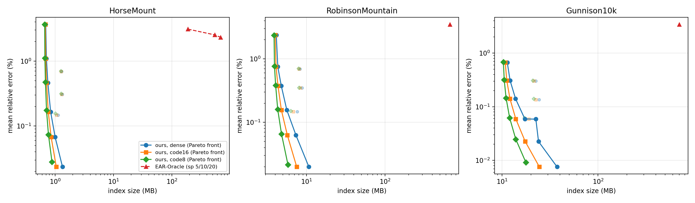

# Size experiments

One build per configuration (C++, hybrid sweeps, single thread, Apple M1), every storage evaluated
on it. `kd` = the current index; `kmax` = version A (portals per cut capped, certify-or-refine);
`shifted` = 3 shifted quadtrees with gap max(g, eps lambda S / 6); storages: `dense` float32,
`code16` / `code8` closed-loop delta coding, `coverX` = X-covers per row. Errors are |estimate/d - 1|
against exact MMP; `refined` = pairs answered by the exact local sweep because UB > (1+eps) LB.
The size-versus-error section has two series of (eps, g in edges): (0.1, 0.5), (0.2, 1), (0.3, 2),
(0.5, 4), (1, 8), where the near radius R = g/(eps lambda) grows from 5 to 8 edges, and (0.4, 2), (0.8, 4),
(1.6, 8), (3.2, 16) with R fixed at 5 edges. The plot shows every configuration and each storage's
Pareto front.

## Gunnison10k (1,500 pairs, eps 0.1, g 0.5 edge)

| configuration | storage | build | index | query | query with refine (mean / p99) | refined | sound | max UB err | mean / max error | max UB/LB |
|---|---|---:|---:|---:|---:|---:|---|---:|---:|---:|
| kd (current) | dense+refine | 123.0 s | 37.39 MB | 0.27 µs | 0.27 / 0.5 µs | 0/1500 | yes | 0.943% | 0.0076% / 0.374% | 1.0557 |
| kd (current) | code16+refine | 123.0 s | 24.46 MB | 0.85 µs | 0.87 / 1.2 µs | 0/1500 | yes | 0.943% | 0.0076% / 0.374% | 1.0557 |
| kd (current) | code8+refine | 123.0 s | 17.70 MB | 0.85 µs | 0.87 / 1.2 µs | 0/1500 | yes | 0.979% | 0.0092% / 0.375% | 1.0562 |
| kd (current) | cover0.002+refine | 123.0 s | 42.97 MB | 1.69 µs | 1.70 / 2.2 µs | 0/1500 | yes | 0.943% | 0.0090% / 0.374% | 1.0557 |
| kd (current) | cover0.01+refine | 123.0 s | 32.11 MB | 1.68 µs | 1.69 / 2.2 µs | 0/1500 | yes | 0.943% | 0.0484% / 0.776% | 1.0558 |
| kd (current) | cover0.05+refine | 123.0 s | 18.93 MB | 1.45 µs | 1.46 / 1.8 µs | 0/1500 | yes | 4.785% | 0.6887% / 4.730% | 1.0922 |
| kmax200 | dense+refine | 124.7 s | 37.39 MB | 0.27 µs | 0.27 / 0.5 µs | 0/1500 | yes | 0.943% | 0.0076% / 0.374% | 1.0557 |
| kmax200 | code16+refine | 124.7 s | 24.46 MB | 0.86 µs | 0.89 / 1.2 µs | 0/1500 | yes | 0.943% | 0.0076% / 0.374% | 1.0557 |
| kmax200 | code8+refine | 124.7 s | 17.70 MB | 0.85 µs | 0.88 / 1.2 µs | 0/1500 | yes | 0.979% | 0.0092% / 0.375% | 1.0562 |
| kmax100 | dense+refine | 122.1 s | 34.97 MB | 0.23 µs | 0.24 / 0.8 µs | 0/1500 | yes | 0.943% | 0.0103% / 0.374% | 1.0557 |
| kmax100 | code16+refine | 122.1 s | 23.24 MB | 0.67 µs | 0.77 / 1.2 µs | 0/1500 | yes | 0.943% | 0.0103% / 0.374% | 1.0557 |
| kmax100 | code8+refine | 122.1 s | 17.09 MB | 0.66 µs | 0.68 / 1.0 µs | 0/1500 | yes | 0.979% | 0.0122% / 0.375% | 1.0562 |
| kmax50 | dense+refine | 110.1 s | 29.67 MB | 0.17 µs | 0.17 / 0.7 µs | 0/1500 | yes | 1.449% | 0.0232% / 0.578% | 1.0551 |
| kmax50 | code16+refine | 110.1 s | 20.59 MB | 0.41 µs | 0.43 / 0.8 µs | 0/1500 | yes | 1.449% | 0.0232% / 0.578% | 1.0551 |
| kmax50 | code8+refine | 110.1 s | 15.75 MB | 0.41 µs | 0.43 / 1.0 µs | 0/1500 | yes | 1.550% | 0.0260% / 0.578% | 1.0558 |
| shifted | dense+refine | 384.3 s | 79.18 MB | 0.19 µs | 0.19 / 0.5 µs | 0/1500 | yes | 1.063% | 0.0279% / 0.820% | 1.0557 |
| shifted | code16+refine | 384.3 s | 49.72 MB | 0.47 µs | 0.48 / 1.1 µs | 0/1500 | yes | 1.063% | 0.0279% / 0.820% | 1.0557 |
| shifted | code8+refine | 384.3 s | 33.96 MB | 0.44 µs | 0.46 / 1.0 µs | 0/1500 | yes | 1.100% | 0.0300% / 0.852% | 1.0559 |

## GunnisonForest100k (200 pairs, eps 0.2, g 1 edge)

| configuration | storage | build | index | query | query with refine (mean / p99) | refined | sound | max UB err | mean / max error | max UB/LB |
|---|---|---:|---:|---:|---:|---:|---|---:|---:|---:|
| kd (current) | dense+refine | 2482.8 s | 533.76 MB | 0.38 µs | 0.39 / 0.6 µs | 0/200 | yes | 0.120% | 0.0069% / 0.120% | 1.0595 |
| kd (current) | code16+refine | 2482.8 s | 329.61 MB | 1.32 µs | 1.34 / 1.8 µs | 0/200 | yes | 0.120% | 0.0069% / 0.120% | 1.0595 |
| kd (current) | code8+refine | 2482.8 s | 224.29 MB | 1.31 µs | 1.34 / 1.8 µs | 0/200 | yes | 0.164% | 0.0075% / 0.111% | 1.0598 |
| kd (current) | cover0.002+refine | 2482.8 s | 606.79 MB | 2.61 µs | 2.65 / 3.7 µs | 0/200 | yes | 0.120% | 0.0094% / 0.120% | 1.0595 |
| kd (current) | cover0.01+refine | 2482.8 s | 417.38 MB | 2.49 µs | 2.49 / 3.3 µs | 0/200 | yes | 0.691% | 0.0738% / 0.691% | 1.0595 |
| kd (current) | cover0.05+refine | 2482.8 s | 230.21 MB | 2.09 µs | 2.10 / 2.7 µs | 0/200 | yes | 4.176% | 0.7910% / 4.166% | 1.0766 |
| kmax200 | dense+refine | 3959.2 s | 511.24 MB | 0.54 µs | 0.54 / 0.8 µs | 0/200 | yes | 0.120% | 0.0083% / 0.120% | 1.0595 |
| kmax200 | code16+refine | 3959.2 s | 318.36 MB | 1.82 µs | 1.85 / 2.3 µs | 0/200 | yes | 0.120% | 0.0083% / 0.120% | 1.0595 |
| kmax200 | code8+refine | 3959.2 s | 218.66 MB | 1.82 µs | 1.85 / 2.3 µs | 0/200 | yes | 0.164% | 0.0091% / 0.111% | 1.0598 |
| kmax100 | dense+refine | 3082.7 s | 430.52 MB | 0.36 µs | 0.37 / 0.7 µs | 0/200 | yes | 0.213% | 0.0162% / 0.213% | 1.0595 |
| kmax100 | code16+refine | 3082.7 s | 277.98 MB | 1.11 µs | 1.14 / 2.1 µs | 0/200 | yes | 0.214% | 0.0162% / 0.213% | 1.0595 |
| kmax100 | code8+refine | 3082.7 s | 198.46 MB | 1.10 µs | 1.12 / 1.5 µs | 0/200 | yes | 0.272% | 0.0174% / 0.211% | 1.0598 |
| kmax50 | dense+refine | 3106.0 s | 346.46 MB | 0.28 µs | 0.29 / 1.2 µs | 0/200 | yes | 0.497% | 0.0392% / 0.313% | 1.0589 |
| kmax50 | code16+refine | 3106.0 s | 235.92 MB | 0.65 µs | 0.67 / 1.1 µs | 0/200 | yes | 0.497% | 0.0392% / 0.313% | 1.0589 |
| kmax50 | code8+refine | 3106.0 s | 177.41 MB | 0.64 µs | 0.67 / 1.0 µs | 0/200 | yes | 0.583% | 0.0408% / 0.322% | 1.0594 |
| shifted | dense+refine | 9193.9 s | 741.86 MB | 0.31 µs | 0.32 / 1.1 µs | 0/200 | yes | 2.193% | 0.1191% / 0.969% | 1.0586 |
| shifted | code16+refine | 9193.9 s | 483.84 MB | 0.55 µs | 0.57 / 1.5 µs | 0/200 | yes | 2.194% | 0.1191% / 0.969% | 1.0586 |
| shifted | code8+refine | 9193.9 s | 343.01 MB | 0.56 µs | 0.57 / 1.4 µs | 0/200 | yes | 2.222% | 0.1205% / 0.938% | 1.0594 |

## Size versus error (kd, no cap)

### HorseMount

| configuration | storage | build | index | query | query with refine (mean / p99) | refined | sound | max UB err | mean / max error | max UB/LB |
|---|---|---:|---:|---:|---:|---:|---|---:|---:|---:|
| eps 0.1, g 0.5e | dense | 2.0 s | 1.34 MB | 0.14 µs | 0.14 / 0.8 µs | 0/1500 | yes | 3.408% | 0.0235% / 1.159% | 1.0881 |
| eps 0.1, g 0.5e | code16 | 2.0 s | 1.05 MB | 0.29 µs | 0.30 / 1.0 µs | 0/1500 | yes | 3.409% | 0.0235% / 1.159% | 1.0881 |
| eps 0.1, g 0.5e | code8 | 2.0 s | 0.88 MB | 0.28 µs | 0.30 / 0.6 µs | 0/1500 | yes | 3.452% | 0.0279% / 1.169% | 1.0886 |
| eps 0.2, g 1e | dense | 1.1 s | 1.00 MB | 0.15 µs | 0.16 / 0.9 µs | 0/1500 | yes | 4.149% | 0.0676% / 1.495% | 1.0660 |
| eps 0.2, g 1e | code16 | 1.1 s | 0.86 MB | 0.24 µs | 0.24 / 1.0 µs | 0/1500 | yes | 4.149% | 0.0676% / 1.494% | 1.0660 |
| eps 0.2, g 1e | code8 | 1.1 s | 0.77 MB | 0.23 µs | 0.26 / 1.0 µs | 0/1500 | yes | 4.244% | 0.0734% / 1.580% | 1.0667 |
| eps 0.3, g 2e | dense | 0.9 s | 1.13 MB | 0.16 µs | 0.16 / 0.8 µs | 0/1500 | yes | 12.033% | 0.1473% / 11.064% | 1.1347 |
| eps 0.3, g 2e | code16 | 0.9 s | 1.06 MB | 0.20 µs | 0.20 / 0.9 µs | 0/1500 | yes | 12.034% | 0.1473% / 11.064% | 1.1347 |
| eps 0.3, g 2e | code8 | 0.9 s | 1.01 MB | 0.20 µs | 0.20 / 0.9 µs | 0/1500 | yes | 12.138% | 0.1556% / 11.106% | 1.1358 |
| eps 0.4, g 2e | dense | 1.2 s | 0.84 MB | 0.27 µs | 0.28 / 1.3 µs | 0/1500 | yes | 12.033% | 0.1657% / 11.064% | 1.1731 |
| eps 0.4, g 2e | code16 | 1.2 s | 0.76 MB | 0.34 µs | 0.34 / 1.4 µs | 0/1500 | yes | 12.034% | 0.1657% / 11.064% | 1.1732 |
| eps 0.4, g 2e | code8 | 1.2 s | 0.71 MB | 0.34 µs | 0.35 / 1.4 µs | 0/1500 | yes | 12.138% | 0.1743% / 11.066% | 1.1764 |
| eps 0.5, g 4e | dense | 0.9 s | 1.33 MB | 0.16 µs | 0.16 / 0.8 µs | 0/1500 | yes | 13.414% | 0.3070% / 12.141% | 1.1587 |
| eps 0.5, g 4e | code16 | 0.9 s | 1.29 MB | 0.19 µs | 0.19 / 0.9 µs | 0/1500 | yes | 13.416% | 0.3070% / 12.141% | 1.1588 |
| eps 0.5, g 4e | code8 | 0.9 s | 1.27 MB | 0.20 µs | 0.20 / 0.9 µs | 0/1500 | yes | 13.707% | 0.3143% / 12.141% | 1.1617 |
| eps 0.8, g 4e | dense | 0.9 s | 0.75 MB | 0.29 µs | 0.30 / 1.3 µs | 0/1500 | yes | 23.921% | 0.4614% / 21.055% | 1.2913 |
| eps 0.8, g 4e | code16 | 0.9 s | 0.71 MB | 0.34 µs | 0.35 / 1.4 µs | 0/1500 | yes | 23.922% | 0.4614% / 21.055% | 1.2914 |
| eps 0.8, g 4e | code8 | 0.9 s | 0.68 MB | 0.35 µs | 0.35 / 1.4 µs | 0/1500 | yes | 24.393% | 0.4726% / 21.055% | 1.3012 |
| eps 1.6, g 8e | dense | 0.8 s | 0.71 MB | 0.30 µs | 0.30 / 1.4 µs | 0/1500 | yes | 54.969% | 1.0928% / 45.471% | 1.5556 |
| eps 1.6, g 8e | code16 | 0.8 s | 0.69 MB | 0.33 µs | 0.33 / 1.4 µs | 0/1500 | yes | 54.972% | 1.0928% / 45.470% | 1.5556 |
| eps 1.6, g 8e | code8 | 0.8 s | 0.67 MB | 0.33 µs | 0.33 / 1.4 µs | 0/1500 | yes | 55.643% | 1.1129% / 45.470% | 1.5624 |
| eps 1, g 8e | dense | 0.8 s | 1.29 MB | 0.17 µs | 0.17 / 0.8 µs | 0/1500 | yes | 26.673% | 0.6894% / 22.748% | 1.3028 |
| eps 1, g 8e | code16 | 0.8 s | 1.27 MB | 0.19 µs | 0.18 / 0.9 µs | 0/1500 | yes | 26.676% | 0.6894% / 22.747% | 1.3028 |
| eps 1, g 8e | code8 | 0.8 s | 1.25 MB | 0.18 µs | 0.18 / 0.9 µs | 0/1500 | yes | 27.131% | 0.7017% / 22.731% | 1.3075 |
| eps 3.2, g 16e | dense | 0.7 s | 0.69 MB | 0.27 µs | 0.26 / 1.4 µs | 0/1500 | yes | 92.174% | 3.6645% / 81.620% | 1.9368 |
| eps 3.2, g 16e | code16 | 0.7 s | 0.68 MB | 0.29 µs | 0.29 / 1.4 µs | 0/1500 | yes | 92.179% | 3.6644% / 81.621% | 1.9369 |
| eps 3.2, g 16e | code8 | 0.7 s | 0.66 MB | 0.29 µs | 0.29 / 1.4 µs | 0/1500 | yes | 93.053% | 3.6762% / 82.595% | 1.9457 |

### RobinsonMountain

| configuration | storage | build | index | query | query with refine (mean / p99) | refined | sound | max UB err | mean / max error | max UB/LB |
|---|---|---:|---:|---:|---:|---:|---|---:|---:|---:|
| eps 0.1, g 0.5e | dense | 27.2 s | 10.70 MB | 0.20 µs | 0.20 / 0.4 µs | 0/1500 | yes | 1.786% | 0.0199% / 1.786% | 1.0832 |
| eps 0.1, g 0.5e | code16 | 27.2 s | 7.49 MB | 0.58 µs | 0.61 / 1.0 µs | 0/1500 | yes | 1.786% | 0.0199% / 1.786% | 1.0832 |
| eps 0.1, g 0.5e | code8 | 27.2 s | 5.79 MB | 0.58 µs | 0.59 / 0.9 µs | 0/1500 | yes | 1.809% | 0.0215% / 1.756% | 1.0851 |
| eps 0.2, g 1e | dense | 15.7 s | 7.33 MB | 0.17 µs | 0.18 / 0.9 µs | 0/1500 | yes | 2.779% | 0.0628% / 1.786% | 1.1146 |
| eps 0.2, g 1e | code16 | 15.7 s | 5.69 MB | 0.35 µs | 0.38 / 1.0 µs | 0/1500 | yes | 2.779% | 0.0628% / 1.786% | 1.1146 |
| eps 0.2, g 1e | code8 | 15.7 s | 4.80 MB | 0.35 µs | 0.36 / 0.9 µs | 0/1500 | yes | 2.835% | 0.0653% / 1.796% | 1.1152 |
| eps 0.3, g 2e | dense | 11.5 s | 7.63 MB | 0.17 µs | 0.17 / 0.8 µs | 0/1500 | yes | 6.792% | 0.1472% / 2.934% | 1.1276 |
| eps 0.3, g 2e | code16 | 11.5 s | 6.78 MB | 0.26 µs | 0.27 / 0.9 µs | 0/1500 | yes | 6.793% | 0.1472% / 2.934% | 1.1276 |
| eps 0.3, g 2e | code8 | 11.5 s | 6.30 MB | 0.26 µs | 0.27 / 0.9 µs | 0/1500 | yes | 7.137% | 0.1509% / 2.925% | 1.1298 |
| eps 0.4, g 2e | dense | 15.5 s | 5.61 MB | 0.27 µs | 0.28 / 1.3 µs | 0/1500 | yes | 6.792% | 0.1563% / 4.227% | 1.1276 |
| eps 0.4, g 2e | code16 | 15.5 s | 4.78 MB | 0.44 µs | 0.44 / 1.5 µs | 0/1500 | yes | 6.793% | 0.1563% / 4.227% | 1.1276 |
| eps 0.4, g 2e | code8 | 15.5 s | 4.29 MB | 0.42 µs | 0.43 / 1.4 µs | 0/1500 | yes | 7.137% | 0.1606% / 4.238% | 1.1303 |
| eps 0.5, g 4e | dense | 10.5 s | 8.75 MB | 0.19 µs | 0.19 / 0.8 µs | 0/1500 | yes | 12.486% | 0.3488% / 5.172% | 1.1845 |
| eps 0.5, g 4e | code16 | 10.5 s | 8.31 MB | 0.25 µs | 0.25 / 0.9 µs | 0/1500 | yes | 12.487% | 0.3488% / 5.173% | 1.1845 |
| eps 0.5, g 4e | code8 | 10.5 s | 8.03 MB | 0.24 µs | 0.25 / 0.9 µs | 0/1500 | yes | 12.655% | 0.3522% / 5.149% | 1.1889 |
| eps 0.8, g 4e | dense | 11.3 s | 4.76 MB | 0.32 µs | 0.32 / 1.3 µs | 0/1500 | yes | 20.172% | 0.3774% / 10.659% | 1.2659 |
| eps 0.8, g 4e | code16 | 11.3 s | 4.32 MB | 0.41 µs | 0.42 / 1.5 µs | 0/1500 | yes | 20.175% | 0.3774% / 10.659% | 1.2659 |
| eps 0.8, g 4e | code8 | 11.3 s | 4.04 MB | 0.41 µs | 0.41 / 1.4 µs | 0/1500 | yes | 20.622% | 0.3823% / 10.659% | 1.2713 |
| eps 1.6, g 8e | dense | 9.0 s | 4.30 MB | 0.36 µs | 0.36 / 1.4 µs | 0/1500 | yes | 57.273% | 0.7521% / 19.169% | 1.6436 |
| eps 1.6, g 8e | code16 | 9.0 s | 4.08 MB | 0.40 µs | 0.40 / 1.4 µs | 0/1500 | yes | 57.277% | 0.7521% / 19.169% | 1.6436 |
| eps 1.6, g 8e | code8 | 9.0 s | 3.90 MB | 0.42 µs | 0.42 / 1.4 µs | 0/1500 | yes | 58.097% | 0.7646% / 19.169% | 1.6505 |
| eps 1, g 8e | dense | 8.6 s | 8.28 MB | 0.21 µs | 0.22 / 0.8 µs | 0/1500 | yes | 31.433% | 0.6943% / 16.712% | 1.3514 |
| eps 1, g 8e | code16 | 8.6 s | 8.06 MB | 0.24 µs | 0.24 / 0.9 µs | 0/1500 | yes | 31.436% | 0.6943% / 16.712% | 1.3514 |
| eps 1, g 8e | code8 | 8.6 s | 7.90 MB | 0.25 µs | 0.24 / 0.9 µs | 0/1500 | yes | 32.009% | 0.7049% / 16.712% | 1.3594 |
| eps 3.2, g 16e | dense | 7.9 s | 4.11 MB | 0.35 µs | 0.34 / 1.3 µs | 0/1500 | yes | 119.483% | 2.3668% / 100.524% | 2.2910 |
| eps 3.2, g 16e | code16 | 7.9 s | 3.98 MB | 0.38 µs | 0.37 / 1.4 µs | 0/1500 | yes | 119.484% | 2.3668% / 100.524% | 2.2910 |
| eps 3.2, g 16e | code8 | 7.9 s | 3.85 MB | 0.38 µs | 0.37 / 1.4 µs | 0/1500 | yes | 121.186% | 2.3603% / 100.654% | 2.2999 |

### Gunnison10k

| configuration | storage | build | index | query | query with refine (mean / p99) | refined | sound | max UB err | mean / max error | max UB/LB |
|---|---|---:|---:|---:|---:|---:|---|---:|---:|---:|
| eps 0.1, g 0.5e | dense | 124.3 s | 37.39 MB | 0.27 µs | 0.27 / 0.5 µs | 0/1500 | yes | 0.943% | 0.0076% / 0.374% | 1.0557 |
| eps 0.1, g 0.5e | code16 | 124.3 s | 24.46 MB | 0.85 µs | 0.87 / 1.2 µs | 0/1500 | yes | 0.943% | 0.0076% / 0.374% | 1.0557 |
| eps 0.1, g 0.5e | code8 | 124.3 s | 17.70 MB | 0.86 µs | 0.87 / 1.2 µs | 0/1500 | yes | 0.979% | 0.0092% / 0.375% | 1.0562 |
| eps 0.2, g 1e | dense | 69.0 s | 23.97 MB | 0.18 µs | 0.18 / 0.4 µs | 0/1500 | yes | 2.021% | 0.0225% / 0.681% | 1.0605 |
| eps 0.2, g 1e | code16 | 69.0 s | 17.41 MB | 0.46 µs | 0.47 / 0.8 µs | 0/1500 | yes | 2.022% | 0.0225% / 0.681% | 1.0605 |
| eps 0.2, g 1e | code8 | 69.0 s | 13.89 MB | 0.46 µs | 0.47 / 0.8 µs | 0/1500 | yes | 2.188% | 0.0248% / 0.681% | 1.0617 |
| eps 0.3, g 2e | dense | 47.6 s | 22.48 MB | 0.16 µs | 0.16 / 0.8 µs | 0/1500 | yes | 4.873% | 0.0588% / 2.773% | 1.0836 |
| eps 0.3, g 2e | code16 | 47.6 s | 19.05 MB | 0.30 µs | 0.31 / 0.9 µs | 0/1500 | yes | 4.874% | 0.0588% / 2.773% | 1.0836 |
| eps 0.3, g 2e | code8 | 47.6 s | 17.14 MB | 0.30 µs | 0.31 / 1.0 µs | 0/1500 | yes | 5.162% | 0.0621% / 2.778% | 1.0850 |
| eps 0.4, g 2e | dense | 68.8 s | 17.26 MB | 0.26 µs | 0.26 / 1.2 µs | 0/1500 | yes | 11.491% | 0.0594% / 2.773% | 1.1443 |
| eps 0.4, g 2e | code16 | 68.8 s | 13.89 MB | 0.48 µs | 0.50 / 1.5 µs | 0/1500 | yes | 11.492% | 0.0594% / 2.773% | 1.1443 |
| eps 0.4, g 2e | code8 | 68.8 s | 11.99 MB | 0.48 µs | 0.51 / 1.6 µs | 0/1500 | yes | 11.688% | 0.0621% / 2.773% | 1.1463 |
| eps 0.5, g 4e | dense | 38.3 s | 24.26 MB | 0.17 µs | 0.18 / 0.8 µs | 0/1500 | yes | 8.346% | 0.1357% / 5.751% | 1.1128 |
| eps 0.5, g 4e | code16 | 38.3 s | 22.47 MB | 0.26 µs | 0.27 / 0.9 µs | 0/1500 | yes | 8.347% | 0.1358% / 5.751% | 1.1129 |
| eps 0.5, g 4e | code8 | 38.3 s | 21.40 MB | 0.25 µs | 0.26 / 0.9 µs | 0/1500 | yes | 8.516% | 0.1412% / 5.723% | 1.1153 |
| eps 0.8, g 4e | dense | 35.1 s | 13.81 MB | 0.18 µs | 0.18 / 0.8 µs | 0/1500 | yes | 14.741% | 0.1410% / 5.751% | 1.1744 |
| eps 0.8, g 4e | code16 | 35.1 s | 12.08 MB | 0.25 µs | 0.26 / 0.9 µs | 0/1500 | yes | 14.743% | 0.1410% / 5.751% | 1.1744 |
| eps 0.8, g 4e | code8 | 35.1 s | 11.00 MB | 0.26 µs | 0.26 / 0.9 µs | 0/1500 | yes | 14.913% | 0.1459% / 5.761% | 1.1762 |
| eps 1.6, g 8e | dense | 22.4 s | 12.11 MB | 0.22 µs | 0.22 / 0.8 µs | 0/1500 | yes | 34.547% | 0.3087% / 15.905% | 1.3940 |
| eps 1.6, g 8e | code16 | 22.4 s | 11.19 MB | 0.26 µs | 0.26 / 0.9 µs | 0/1500 | yes | 34.550% | 0.3087% / 15.905% | 1.3941 |
| eps 1.6, g 8e | code8 | 22.4 s | 10.52 MB | 0.25 µs | 0.25 / 0.9 µs | 0/1500 | yes | 35.281% | 0.3166% / 16.166% | 1.4056 |
| eps 1, g 8e | dense | 30.6 s | 22.46 MB | 0.22 µs | 0.22 / 0.8 µs | 0/1500 | yes | 29.267% | 0.3017% / 15.905% | 1.3154 |
| eps 1, g 8e | code16 | 30.6 s | 21.54 MB | 0.26 µs | 0.26 / 0.9 µs | 0/1500 | yes | 29.268% | 0.3017% / 15.905% | 1.3154 |
| eps 1, g 8e | code8 | 30.6 s | 20.91 MB | 0.25 µs | 0.26 / 0.9 µs | 0/1500 | yes | 29.783% | 0.3081% / 16.166% | 1.3206 |
| eps 3.2, g 16e | dense | 19.3 s | 11.32 MB | 0.22 µs | 0.22 / 0.9 µs | 0/1500 | yes | 155.388% | 0.6684% / 69.697% | 2.5554 |
| eps 3.2, g 16e | code16 | 19.3 s | 10.78 MB | 0.25 µs | 0.25 / 0.9 µs | 0/1500 | yes | 155.397% | 0.6684% / 69.697% | 2.5555 |
| eps 3.2, g 16e | code8 | 19.3 s | 10.31 MB | 0.26 µs | 0.25 / 0.9 µs | 0/1500 | yes | 155.903% | 0.6824% / 69.697% | 2.5606 |

