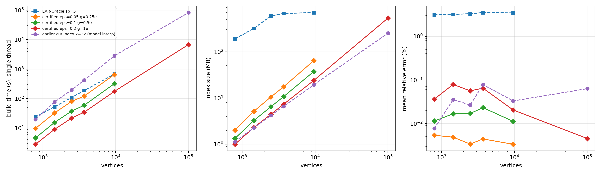
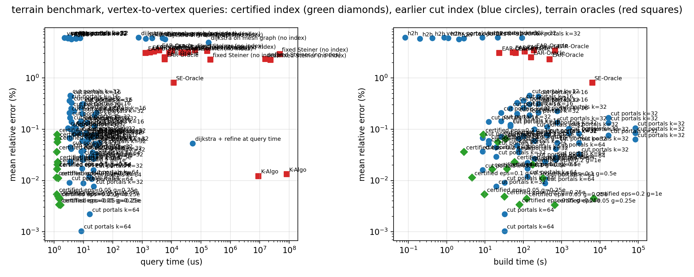
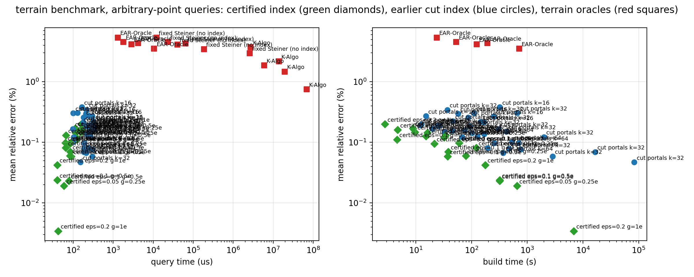

# Terrain benchmark: Certified Cut Index vs terrain distance oracles

The certified index (`rgeo/oracles/certified.py`, theorem and proofs in `notes/guarantee.md`)
returns with every answer an interval LB <= d <= UB with (1-eps) d <= LB and UB <= (1+eps) d;
`(UB)` rows answer with the upper bound (the length of an actual path), `(estimate)` rows with
the interpolated minimum clamped into the interval. Its query is timed in C (`rgeo/oracles/
cquery.py`, identical answers) and in Python. Rows `cut portals k=...` are the earlier,
uncertified index, kept for comparison.

## Certified index on every mesh

| mesh | n | eps / g | build (s) | index (MB) | query C / Python (us) | mean err | p90 err | max err | max UB err | LB <= d <= UB | UB/LB width (median) |
|---|---:|---|---:|---:|---:|---:|---:|---:|---:|---|---:|
| HorseMount | 793 | 0.2 / 1e | 2.8 | 1.00 | 1.2 / 37.1 | 0.0363% | 0.110% | 0.543% | 1.666% | yes | 1.77% |
| HorseMount | 793 | 0.1 / 0.5e | 4.6 | 1.34 | 1.2 / 30.9 | 0.0114% | 0.039% | 0.135% | 0.616% | yes | 1.68% |
| HorseMount | 793 | 0.05 / 0.25e | 9.7 | 2.01 | 1.2 / 27.5 | 0.0054% | 0.017% | 0.061% | 0.140% | yes | 1.18% |
| BigMount | 1440 | 0.2 / 1e | 8.9 | 2.31 | 1.2 / 40.3 | 0.0788% | 0.192% | 1.826% | 1.826% | yes | 3.33% |
| BigMount | 1440 | 0.1 / 0.5e | 15.3 | 3.26 | 1.3 / 33.2 | 0.0167% | 0.042% | 0.284% | 0.284% | yes | 2.07% |
| BigMount | 1440 | 0.05 / 0.25e | 32.1 | 5.15 | 1.4 / 33.1 | 0.0049% | 0.014% | 0.064% | 0.068% | yes | 1.15% |
| HeadlightMount | 2470 | 0.2 / 1e | 21.5 | 4.43 | 1.3 / 39.6 | 0.0561% | 0.132% | 0.794% | 1.235% | yes | 1.67% |
| HeadlightMount | 2470 | 0.1 / 0.5e | 37.1 | 6.46 | 1.3 / 33.2 | 0.0170% | 0.041% | 0.357% | 0.493% | yes | 1.25% |
| HeadlightMount | 2470 | 0.05 / 0.25e | 79.4 | 10.52 | 1.5 / 31.7 | 0.0034% | 0.010% | 0.084% | 0.093% | yes | 0.81% |
| RobinsonMountain | 3696 | 0.2 / 1e | 34.2 | 7.33 | 1.3 / 38.8 | 0.0647% | 0.131% | 1.185% | 2.208% | yes | 2.87% |
| RobinsonMountain | 3696 | 0.1 / 0.5e | 59.0 | 10.70 | 1.3 / 35.1 | 0.0232% | 0.048% | 0.384% | 0.384% | yes | 1.64% |
| RobinsonMountain | 3696 | 0.05 / 0.25e | 121.2 | 17.47 | 1.5 / 32.6 | 0.0044% | 0.016% | 0.074% | 0.074% | yes | 0.85% |
| Gunnison10k | 9610 | 0.2 / 1e | 175.3 | 23.97 | 1.3 / 34.4 | 0.0205% | 0.057% | 0.143% | 0.200% | yes | 1.62% |
| Gunnison10k | 9610 | 0.1 / 0.5e | 320.1 | 37.39 | 1.4 / 34.3 | 0.0112% | 0.021% | 0.301% | 0.301% | yes | 1.04% |
| Gunnison10k | 9610 | 0.05 / 0.25e | 652.9 | 64.22 | 1.6 / 31.8 | 0.0033% | 0.008% | 0.083% | 0.083% | yes | 0.56% |
| GunnisonForest100k | 100511 | 0.2 / 1e | 6854.4 | 533.75 | 1.6 / 30.6 | 0.0045% | 0.014% | 0.042% | 0.075% | yes | 0.63% |

Every method answers the same 100 random vertex-to-vertex queries and the same 100 random
arbitrary-point queries per mesh (uniform random face, uniform barycentric coordinates); the truth
is the exact polyhedral geodesic (MMP, `pygeodesic`, double precision, query points inserted as
Steiner vertices). Errors are relative and signed: the competitors (K-Algo, SE-Oracle) can answer
below the truth, ours is >= 0 except the interpolated variants. `build` is single-threaded wall
time on an Apple M1 for everyone (ours: Python + pygeodesic sweeps; theirs: their C++ harness).
`index` is our label bytes vs. their reported resident-memory delta (which includes their
Steiner base graph). Our `k` is portals per cut, uniform across the tree; `k~|cut|` is the budget
proportional to cut length (`k_min=4`). Arbitrary points are attached to the vertex index either
by `snap` (through the face's vertices, an admissible upper bound, first order in the edge
length) or by `interp` (bilinear interpolation of the 3x3 vertex-pair answers, second order,
two-sided); pairs within 4 rings are answered exactly by a local sweep.

## Vertex-to-vertex queries

### HorseMount: 793 vertices, 1488 faces, 100 vertex-to-vertex queries, exact geodesic (pygeodesic) 9 ms/query

| method | build (s) | index (MB) | query (us) | mean err | p90 err | max err |
|---|---:|---:|---:|---:|---:|---:|
| dijkstra on mesh graph (no index) | 0.0 | 0.00 | 750.9 | 6.141% | 10.127% | 39.62% |
| h2h | 0.1 | 0.65 | 5.6 | 6.141% | 10.127% | 39.62% |
| vertex portals k=32 | 0.9 | 0.77 | 3.0 | 6.161% | 10.127% | 39.62% |
| cut portals k=16, exact MMP labels | 12.5 | 0.82 | 3.9 | 0.139% | 0.302% | 2.47% |
| cut portals k=16, exact MMP labels + interp | 12.5 | 0.82 | 9.6 | 0.059% | 0.189% | 2.47% |
| cut portals k=16, exact MMP labels + model interp | 12.5 | 0.82 | 24.6 | 0.052% | 0.121% | 2.47% |
| cut portals k=32, exact MMP labels | 19.7 | 1.14 | 3.6 | 0.045% | 0.122% | 0.86% |
| cut portals k=32, exact MMP labels + interp | 19.7 | 1.14 | 9.0 | 0.029% | 0.071% | 0.83% |
| cut portals k=32, exact MMP labels + model interp | 19.7 | 1.14 | 22.4 | 0.008% | 0.035% | 0.11% |
| cut portals k=32, exact MMP labels, k~|cut| | 8.7 | 0.85 | 3.3 | 0.068% | 0.150% | 0.86% |
| cut portals k=32, exact MMP labels, k~|cut| + interp | 8.7 | 0.85 | 8.4 | 0.037% | 0.086% | 0.83% |
| cut portals k=32, exact MMP labels, k~|cut| + model interp | 8.7 | 0.85 | 21.7 | 0.016% | 0.048% | 0.39% |
| cut portals k=64, exact MMP labels | 32.4 | 1.78 | 3.3 | 0.009% | 0.016% | 0.16% |
| cut portals k=64, exact MMP labels + interp | 32.4 | 1.78 | 8.5 | 0.001% | 0.008% | 0.06% |
| cut portals k=64, exact MMP labels + model interp | 32.4 | 1.78 | 16.3 | 0.002% | 0.008% | 0.03% |
| cut portals k=32, refined labels (rounds=1, seg=12) | 1526.6 | 2.06 | 5.7 | 0.103% | 0.200% | 2.46% |
| cut portals k=32, refined labels (rounds=1, seg=12) + interp | 1526.6 | 2.06 | 12.1 | 0.085% | 0.147% | 2.26% |
| certified eps=0.2 g=1e, exact MMP (UB) | 2.8 | 1.00 | 1.2 | 0.103% | 0.189% | 1.67% |
| certified eps=0.2 g=1e, exact MMP (estimate) | 2.8 | 1.00 | 1.2 | 0.036% | 0.110% | 0.54% |
| certified eps=0.1 g=0.5e, exact MMP (UB) | 4.6 | 1.34 | 1.2 | 0.031% | 0.063% | 0.62% |
| certified eps=0.1 g=0.5e, exact MMP (estimate) | 4.6 | 1.34 | 1.2 | 0.011% | 0.039% | 0.13% |
| certified eps=0.05 g=0.25e, exact MMP (UB) | 9.7 | 2.01 | 1.2 | 0.010% | 0.027% | 0.14% |
| certified eps=0.05 g=0.25e, exact MMP (estimate) | 9.7 | 2.01 | 1.2 | 0.005% | 0.017% | 0.06% |
| dijkstra + refine at query time | 0.0 | 0.00 | 52093.5 | 0.053% | 0.113% | 0.56% |
| EAR-Oracle sp=5 eps=0.05 | 63.3 | 348.00 | 8289.1 | 3.102% | 5.172% | 24.51% |
| EAR-Oracle sp=10 eps=0.2 | 156.4 | 541.00 | 5700.5 | 2.534% | 4.155% | 22.74% |
| EAR-Oracle sp=20 eps=0.2 | 484.0 | 683.00 | 5698.4 | 2.324% | 3.908% | 18.61% |
| EAR-Oracle sp=5 eps=0.2 | 23.5 | 189.00 | 1276.9 | 3.102% | 5.172% | 24.51% |
| fixed Steiner (no index) sp=20 | 0.0 | 0.00 | 208328.8 | 2.312% | 3.911% | 18.61% |
| fixed Steiner (no index) sp=5 | 0.0 | 0.00 | 26381.5 | 3.105% | 5.174% | 24.51% |
| K-Algo eps=0.05 | 0.0 | 0.00 | 8056282.1 | -0.018% | 0.021% | 1.58% |
| K-Algo eps=0.2 | 0.0 | 0.00 | 8146797.0 | -0.018% | 0.021% | 1.58% |
| MMP (exact, no index) | 0.0 | 0.00 | 34388.0 | 0.000% | 0.002% | 0.01% |
| SE-Oracle sp=5 eps=0.2 | 6251.7 | 942.00 | 11640.3 | 0.814% | 5.296% | 20.54% |
| unfixed Steiner (no index) eps=0.05 | 0.0 | 0.00 | 23179799.6 | 2.283% | 3.803% | 19.92% |
| unfixed Steiner (no index) eps=0.2 | 0.0 | 0.00 | 15098081.8 | 2.370% | 3.909% | 20.20% |

### BigMount: 1440 vertices, 2772 faces, 100 vertex-to-vertex queries, exact geodesic (pygeodesic) 19 ms/query

| method | build (s) | index (MB) | query (us) | mean err | p90 err | max err |
|---|---:|---:|---:|---:|---:|---:|
| dijkstra on mesh graph (no index) | 0.0 | 0.00 | 1319.0 | 5.820% | 8.182% | 11.58% |
| h2h | 0.2 | 1.84 | 5.6 | 5.820% | 8.182% | 11.58% |
| vertex portals k=32 | 2.8 | 1.71 | 3.0 | 5.936% | 8.289% | 15.90% |
| cut portals k=16, exact MMP labels | 46.1 | 1.60 | 3.8 | 0.253% | 0.550% | 1.62% |
| cut portals k=16, exact MMP labels + interp | 46.1 | 1.60 | 8.8 | 0.122% | 0.468% | 1.22% |
| cut portals k=16, exact MMP labels + model interp | 46.1 | 1.60 | 23.5 | 0.116% | 0.323% | 1.31% |
| cut portals k=32, exact MMP labels | 75.7 | 2.27 | 3.5 | 0.066% | 0.129% | 0.80% |
| cut portals k=32, exact MMP labels + interp | 75.7 | 2.27 | 9.8 | 0.038% | 0.100% | 0.73% |
| cut portals k=32, exact MMP labels + model interp | 75.7 | 2.27 | 20.2 | 0.035% | 0.092% | 0.64% |
| cut portals k=32, exact MMP labels, k~|cut| | 26.5 | 1.44 | 3.3 | 0.209% | 0.493% | 2.26% |
| cut portals k=32, exact MMP labels, k~|cut| + interp | 26.5 | 1.44 | 8.2 | 0.144% | 0.403% | 2.25% |
| cut portals k=32, exact MMP labels, k~|cut| + model interp | 26.5 | 1.44 | 20.2 | 0.071% | 0.263% | 1.01% |
| cut portals k=64, exact MMP labels | 128.2 | 3.63 | 3.6 | 0.022% | 0.059% | 0.32% |
| cut portals k=64, exact MMP labels + interp | 128.2 | 3.63 | 9.0 | 0.017% | 0.050% | 0.31% |
| cut portals k=64, exact MMP labels + model interp | 128.2 | 3.63 | 15.6 | 0.012% | 0.026% | 0.31% |
| certified eps=0.2 g=1e, exact MMP (UB) | 8.9 | 2.31 | 1.2 | 0.113% | 0.238% | 1.83% |
| certified eps=0.2 g=1e, exact MMP (estimate) | 8.9 | 2.31 | 1.2 | 0.079% | 0.192% | 1.83% |
| certified eps=0.1 g=0.5e, exact MMP (UB) | 15.3 | 3.26 | 1.3 | 0.025% | 0.065% | 0.28% |
| certified eps=0.1 g=0.5e, exact MMP (estimate) | 15.3 | 3.26 | 1.3 | 0.017% | 0.042% | 0.28% |
| certified eps=0.05 g=0.25e, exact MMP (UB) | 32.1 | 5.15 | 1.4 | 0.008% | 0.025% | 0.07% |
| certified eps=0.05 g=0.25e, exact MMP (estimate) | 32.1 | 5.15 | 1.4 | 0.005% | 0.014% | 0.06% |
| EAR-Oracle sp=5 eps=0.2 | 52.4 | 319.00 | 1790.8 | 3.191% | 4.518% | 6.41% |
| fixed Steiner (no index) sp=5 | 0.0 | 0.00 | 21189.5 | 3.172% | 4.490% | 6.41% |
| K-Algo eps=0.2 | 0.0 | 0.00 | 5236204.9 | -0.016% | 0.018% | 0.24% |
| MMP (exact, no index) | 0.0 | 0.00 | 29799.3 | -0.000% | 0.001% | 0.00% |

### HeadlightMount: 2470 vertices, 4771 faces, 100 vertex-to-vertex queries, exact geodesic (pygeodesic) 39 ms/query

| method | build (s) | index (MB) | query (us) | mean err | p90 err | max err |
|---|---:|---:|---:|---:|---:|---:|
| dijkstra on mesh graph (no index) | 0.0 | 0.00 | 2190.9 | 5.998% | 8.339% | 17.81% |
| h2h | 0.4 | 4.19 | 5.7 | 5.998% | 8.339% | 17.81% |
| vertex portals k=32 | 8.5 | 3.36 | 3.1 | 6.168% | 8.717% | 17.81% |
| cut portals k=16, exact MMP labels | 101.1 | 2.87 | 3.3 | 0.360% | 0.922% | 4.96% |
| cut portals k=16, exact MMP labels + interp | 101.1 | 2.87 | 8.4 | 0.264% | 0.842% | 4.21% |
| cut portals k=16, exact MMP labels + model interp | 101.1 | 2.87 | 24.2 | 0.073% | 0.231% | 1.45% |
| cut portals k=32, exact MMP labels | 194.2 | 4.20 | 3.6 | 0.100% | 0.208% | 1.09% |
| cut portals k=32, exact MMP labels + interp | 194.2 | 4.20 | 9.0 | 0.059% | 0.111% | 1.00% |
| cut portals k=32, exact MMP labels + model interp | 194.2 | 4.20 | 22.3 | 0.027% | 0.089% | 0.41% |
| cut portals k=32, exact MMP labels, k~|cut| | 68.0 | 2.49 | 3.9 | 0.330% | 0.644% | 7.96% |
| cut portals k=32, exact MMP labels, k~|cut| + interp | 68.0 | 2.49 | 9.0 | 0.200% | 0.461% | 5.02% |
| cut portals k=32, exact MMP labels, k~|cut| + model interp | 68.0 | 2.49 | 27.9 | 0.048% | 0.229% | 0.41% |
| cut portals k=64, exact MMP labels | 370.5 | 6.86 | 3.6 | 0.023% | 0.064% | 0.22% |
| cut portals k=64, exact MMP labels + interp | 370.5 | 6.86 | 9.9 | 0.009% | 0.040% | 0.17% |
| cut portals k=64, exact MMP labels + model interp | 370.5 | 6.86 | 19.1 | 0.011% | 0.031% | 0.17% |
| certified eps=0.2 g=1e, exact MMP (UB) | 21.5 | 4.43 | 1.3 | 0.111% | 0.294% | 1.23% |
| certified eps=0.2 g=1e, exact MMP (estimate) | 21.5 | 4.43 | 1.3 | 0.056% | 0.132% | 0.79% |
| certified eps=0.1 g=0.5e, exact MMP (UB) | 37.1 | 6.46 | 1.3 | 0.031% | 0.066% | 0.49% |
| certified eps=0.1 g=0.5e, exact MMP (estimate) | 37.1 | 6.46 | 1.3 | 0.017% | 0.041% | 0.36% |
| certified eps=0.05 g=0.25e, exact MMP (UB) | 79.4 | 10.52 | 1.5 | 0.007% | 0.017% | 0.09% |
| certified eps=0.05 g=0.25e, exact MMP (estimate) | 79.4 | 10.52 | 1.5 | 0.003% | 0.010% | 0.08% |
| EAR-Oracle sp=5 eps=0.2 | 107.3 | 592.00 | 2479.6 | 3.291% | 4.921% | 8.47% |
| fixed Steiner (no index) sp=5 | 0.0 | 0.00 | 35783.8 | 3.275% | 4.920% | 8.47% |
| K-Algo eps=0.2 (20 queries) | 0.0 | 0.00 | 8917120.3 | 0.012% | 0.016% | 0.04% |
| MMP (exact, no index) | 0.0 | 0.00 | 72864.4 | -0.000% | 0.001% | 0.00% |

### RobinsonMountain: 3696 vertices, 7200 faces, 100 vertex-to-vertex queries, exact geodesic (pygeodesic) 57 ms/query

| method | build (s) | index (MB) | query (us) | mean err | p90 err | max err |
|---|---:|---:|---:|---:|---:|---:|
| dijkstra on mesh graph (no index) | 0.0 | 0.00 | 4874.9 | 5.958% | 9.362% | 15.24% |
| h2h | 1.1 | 8.00 | 7.6 | 5.958% | 9.362% | 15.24% |
| vertex portals k=32 | 21.4 | 5.57 | 3.3 | 6.188% | 9.362% | 15.24% |
| cut portals k=16, exact MMP labels | 248.0 | 4.66 | 3.8 | 0.435% | 0.847% | 9.83% |
| cut portals k=16, exact MMP labels + interp | 248.0 | 4.66 | 9.6 | 0.312% | 0.748% | 9.21% |
| cut portals k=16, exact MMP labels + model interp | 248.0 | 4.66 | 27.7 | 0.213% | 0.671% | 1.90% |
| cut portals k=32, exact MMP labels | 421.0 | 6.62 | 4.7 | 0.111% | 0.276% | 1.58% |
| cut portals k=32, exact MMP labels + interp | 421.0 | 6.62 | 12.0 | 0.076% | 0.239% | 1.23% |
| cut portals k=32, exact MMP labels + model interp | 421.0 | 6.62 | 27.0 | 0.078% | 0.214% | 1.58% |
| cut portals k=32, exact MMP labels, k~|cut| | 145.6 | 4.12 | 3.6 | 0.452% | 0.775% | 10.41% |
| cut portals k=32, exact MMP labels, k~|cut| + interp | 145.6 | 4.12 | 9.0 | 0.308% | 0.551% | 10.27% |
| cut portals k=32, exact MMP labels, k~|cut| + model interp | 145.6 | 4.12 | 23.9 | 0.187% | 0.381% | 3.49% |
| cut portals k=64, exact MMP labels | 702.6 | 10.53 | 3.9 | 0.041% | 0.096% | 0.51% |
| cut portals k=64, exact MMP labels + interp | 702.6 | 10.53 | 9.7 | 0.025% | 0.066% | 0.46% |
| cut portals k=64, exact MMP labels + model interp | 702.6 | 10.53 | 17.6 | 0.028% | 0.056% | 0.51% |
| certified eps=0.2 g=1e, exact MMP (UB) | 34.2 | 7.33 | 1.3 | 0.102% | 0.196% | 2.21% |
| certified eps=0.2 g=1e, exact MMP (estimate) | 34.2 | 7.33 | 1.3 | 0.065% | 0.131% | 1.19% |
| certified eps=0.1 g=0.5e, exact MMP (UB) | 59.0 | 10.70 | 1.3 | 0.027% | 0.059% | 0.38% |
| certified eps=0.1 g=0.5e, exact MMP (estimate) | 59.0 | 10.70 | 1.3 | 0.023% | 0.048% | 0.38% |
| certified eps=0.05 g=0.25e, exact MMP (UB) | 121.2 | 17.47 | 1.5 | 0.007% | 0.019% | 0.07% |
| certified eps=0.05 g=0.25e, exact MMP (estimate) | 121.2 | 17.47 | 1.5 | 0.004% | 0.016% | 0.07% |
| EAR-Oracle sp=5 eps=0.2 | 188.4 | 672.00 | 3778.0 | 3.500% | 5.557% | 8.60% |
| fixed Steiner (no index) sp=5 | 0.0 | 0.00 | 61550.1 | 3.484% | 5.552% | 8.60% |
| K-Algo eps=0.2 (20 queries) | 0.0 | 0.00 | 20776729.2 | -0.097% | 0.016% | 0.13% |
| MMP (exact, no index) | 0.0 | 0.00 | 108453.3 | 0.000% | 0.001% | 0.01% |

### Gunnison10k: 9610 vertices, 18819 faces, 100 vertex-to-vertex queries, exact geodesic (pygeodesic) 239 ms/query

| method | build (s) | index (MB) | query (us) | mean err | p90 err | max err |
|---|---:|---:|---:|---:|---:|---:|
| dijkstra on mesh graph (no index) | 0.0 | 0.00 | 5965.7 | 5.700% | 7.310% | 14.71% |
| h2h | 2.1 | 37.53 | 3.9 | 5.700% | 7.310% | 14.71% |
| vertex portals k=32 | 92.2 | 17.69 | 2.2 | 6.058% | 7.571% | 17.89% |
| cut portals k=32, exact MMP labels | 2837.7 | 19.27 | 4.8 | 0.083% | 0.151% | 1.83% |
| cut portals k=32, exact MMP labels + interp | 2837.7 | 19.27 | 12.0 | 0.054% | 0.117% | 1.81% |
| cut portals k=32, exact MMP labels + model interp | 2837.7 | 19.27 | 26.0 | 0.033% | 0.102% | 0.52% |
| cut portals k=32, exact MMP labels, k~|cut| | 765.8 | 10.70 | 4.8 | 0.226% | 0.566% | 2.58% |
| cut portals k=32, exact MMP labels, k~|cut| + interp | 765.8 | 10.70 | 13.4 | 0.135% | 0.416% | 1.91% |
| cut portals k=32, exact MMP labels, k~|cut| + model interp | 765.8 | 10.70 | 34.4 | 0.054% | 0.197% | 0.52% |
| certified eps=0.2 g=1e, exact MMP (UB) | 175.3 | 23.97 | 1.3 | 0.030% | 0.071% | 0.20% |
| certified eps=0.2 g=1e, exact MMP (estimate) | 175.3 | 23.97 | 1.3 | 0.020% | 0.057% | 0.14% |
| certified eps=0.1 g=0.5e, exact MMP (UB) | 320.1 | 37.39 | 1.4 | 0.015% | 0.040% | 0.30% |
| certified eps=0.1 g=0.5e, exact MMP (estimate) | 320.1 | 37.39 | 1.4 | 0.011% | 0.021% | 0.30% |
| certified eps=0.05 g=0.25e, exact MMP (UB) | 652.9 | 64.22 | 1.7 | 0.005% | 0.010% | 0.08% |
| certified eps=0.05 g=0.25e, exact MMP (estimate) | 652.9 | 64.22 | 1.6 | 0.003% | 0.008% | 0.08% |
| EAR-Oracle sp=5 eps=0.2 | 669.5 | 702.00 | 10203.2 | 3.434% | 4.296% | 9.37% |
| fixed Steiner (no index) sp=5 | 0.0 | 0.00 | 161520.0 | 3.371% | 4.296% | 9.37% |
| K-Algo eps=0.2 (20 queries) | 0.0 | 0.00 | 80675852.0 | 0.013% | 0.014% | 0.07% |
| MMP (exact, no index) | 0.0 | 0.00 | 478735.3 | 0.000% | 0.000% | 0.00% |

### GunnisonForest100k: 100511 vertices, 199998 faces, 100 vertex-to-vertex queries, exact geodesic (pygeodesic) 3283 ms/query

| method | build (s) | index (MB) | query (us) | mean err | p90 err | max err |
|---|---:|---:|---:|---:|---:|---:|
| dijkstra on mesh graph (no index) | 0.0 | 0.00 | 180440.0 | 4.955% | 5.727% | 9.86% |
| cut portals k=32, exact MMP labels | 83463.6 | 252.22 | 3.0 | 0.105% | 0.195% | 1.00% |
| cut portals k=32, exact MMP labels + interp | 83463.6 | 252.22 | 7.4 | 0.084% | 0.138% | 0.98% |
| cut portals k=32, exact MMP labels + model interp | 83463.6 | 252.22 | 14.8 | 0.063% | 0.138% | 0.45% |
| cut portals k=32, exact MMP labels, k~|cut| | 16544.9 | 130.19 | 3.5 | 0.168% | 0.340% | 3.19% |
| cut portals k=32, exact MMP labels, k~|cut| + interp | 16544.9 | 130.19 | 7.6 | 0.133% | 0.276% | 3.18% |
| cut portals k=32, exact MMP labels, k~|cut| + model interp | 16544.9 | 130.19 | 20.4 | 0.076% | 0.249% | 0.45% |
| certified eps=0.2 g=1e, exact MMP (UB) | 6854.4 | 533.75 | 1.5 | 0.007% | 0.017% | 0.07% |
| certified eps=0.2 g=1e, exact MMP (estimate) | 6854.4 | 533.75 | 1.6 | 0.005% | 0.014% | 0.04% |
| fixed Steiner (no index) sp=5 | 0.0 | 0.00 | 46828316.6 | 2.928% | 3.502% | 6.56% |
| MMP (exact, no index) | 0.0 | 0.00 | 20905299.1 | 0.000% | 0.000% | 0.00% |

## Arbitrary-point queries

### HorseMount: 793 vertices, 1488 faces, 100 arbitrary-point queries

| method | build (s) | index (MB) | query (us) | mean err | p90 err | max err |
|---|---:|---:|---:|---:|---:|---:|
| cut portals k=16, exact MMP labels + interp, A2A interp | 15.1 | 1.10 | 252.1 | 0.272% | 0.592% | 3.58% |
| cut portals k=16, exact MMP labels + interp, A2A snap | 15.1 | 1.10 | 253.9 | 1.830% | 4.599% | 20.32% |
| cut portals k=16, exact MMP labels + model interp, A2A interp | 12.5 | 0.82 | 360.0 | 0.198% | 0.468% | 3.47% |
| cut portals k=16, exact MMP labels + model interp, A2A snap | 12.5 | 0.82 | 353.4 | 1.769% | 3.831% | 20.32% |
| cut portals k=32, exact MMP labels + interp, A2A interp | 24.6 | 1.73 | 251.5 | 0.188% | 0.397% | 3.64% |
| cut portals k=32, exact MMP labels + interp, A2A snap | 24.6 | 1.73 | 267.0 | 1.762% | 4.465% | 20.32% |
| cut portals k=32, exact MMP labels + model interp, A2A interp | 19.7 | 1.14 | 285.0 | 0.169% | 0.363% | 3.64% |
| cut portals k=32, exact MMP labels + model interp, A2A snap | 19.7 | 1.14 | 298.2 | 1.736% | 3.924% | 20.32% |
| cut portals k=32, exact MMP labels, k~|cut| + interp, A2A interp | 11.9 | 1.18 | 252.4 | 0.192% | 0.395% | 3.50% |
| cut portals k=32, exact MMP labels, k~|cut| + interp, A2A snap | 11.9 | 1.18 | 253.4 | 1.786% | 4.469% | 20.32% |
| cut portals k=32, exact MMP labels, k~|cut| + model interp, A2A interp | 8.7 | 0.85 | 339.2 | 0.171% | 0.368% | 3.47% |
| cut portals k=32, exact MMP labels, k~|cut| + model interp, A2A snap | 8.7 | 0.85 | 273.4 | 1.745% | 3.884% | 20.32% |
| cut portals k=64, exact MMP labels + interp, A2A interp | 44.9 | 2.98 | 257.9 | 0.156% | 0.342% | 3.48% |
| cut portals k=64, exact MMP labels + interp, A2A snap | 44.9 | 2.98 | 257.0 | 1.735% | 4.062% | 20.32% |
| cut portals k=64, exact MMP labels + model interp, A2A interp | 32.4 | 1.78 | 260.1 | 0.149% | 0.342% | 3.48% |
| cut portals k=64, exact MMP labels + model interp, A2A snap | 32.4 | 1.78 | 242.3 | 1.723% | 3.890% | 20.32% |
| certified eps=0.2 g=1e, exact MMP, A2A interp | 2.8 | 1.00 | 159.2 | 0.200% | 0.407% | 3.48% |
| certified eps=0.1 g=0.5e, exact MMP, A2A certified | 4.6 | 1.34 | 122.9 | 0.111% | 0.302% | 0.63% |
| certified eps=0.1 g=0.5e, exact MMP, A2A interp | 4.7 | 1.34 | 162.7 | 0.160% | 0.346% | 3.48% |
| certified eps=0.05 g=0.25e, exact MMP, A2A interp | 9.7 | 2.01 | 156.7 | 0.148% | 0.337% | 3.48% |
| EAR-Oracle sp=5 eps=0.2 | 23.6 | 371.00 | 1297.7 | 5.408% | 8.375% | 84.93% |
| fixed Steiner (no index) sp=5 | 0.0 | 0.00 | 12026.5 | 5.390% | 8.375% | 84.93% |
| MMP (exact, no index) | 0.0 | 0.00 | 14427.6 | -0.000% | 0.000% | 0.00% |
| K-Algo eps=0.2 | 0.0 | 0.00 | 2707432.9 | 3.732% | 4.901% | 160.79% |

### BigMount: 1440 vertices, 2772 faces, 100 arbitrary-point queries

| method | build (s) | index (MB) | query (us) | mean err | p90 err | max err |
|---|---:|---:|---:|---:|---:|---:|
| cut portals k=16, exact MMP labels + interp, A2A interp | 57.0 | 2.21 | 208.0 | 0.297% | 0.758% | 2.69% |
| cut portals k=16, exact MMP labels + interp, A2A snap | 57.0 | 2.21 | 207.7 | 1.722% | 3.821% | 20.20% |
| cut portals k=16, exact MMP labels + model interp, A2A interp | 46.1 | 1.60 | 317.8 | 0.222% | 0.425% | 2.68% |
| cut portals k=16, exact MMP labels + model interp, A2A snap | 46.1 | 1.60 | 321.0 | 1.652% | 3.380% | 20.20% |
| cut portals k=32, exact MMP labels + interp, A2A interp | 93.6 | 3.53 | 213.1 | 0.184% | 0.554% | 2.68% |
| cut portals k=32, exact MMP labels + interp, A2A snap | 93.6 | 3.53 | 208.8 | 1.643% | 3.596% | 20.20% |
| cut portals k=32, exact MMP labels + model interp, A2A interp | 75.7 | 2.27 | 269.3 | 0.159% | 0.391% | 2.68% |
| cut portals k=32, exact MMP labels + model interp, A2A snap | 75.7 | 2.27 | 271.8 | 1.614% | 3.229% | 20.20% |
| cut portals k=32, exact MMP labels, k~|cut| + interp, A2A interp | 36.8 | 1.93 | 216.3 | 0.344% | 0.658% | 5.45% |
| cut portals k=32, exact MMP labels, k~|cut| + interp, A2A snap | 36.8 | 1.93 | 216.8 | 1.783% | 3.940% | 20.20% |
| cut portals k=32, exact MMP labels, k~|cut| + model interp, A2A interp | 26.5 | 1.44 | 277.6 | 0.189% | 0.443% | 2.68% |
| cut portals k=32, exact MMP labels, k~|cut| + model interp, A2A snap | 26.5 | 1.44 | 241.9 | 1.643% | 3.248% | 20.20% |
| cut portals k=64, exact MMP labels + interp, A2A interp | 167.8 | 6.18 | 218.8 | 0.136% | 0.268% | 2.68% |
| cut portals k=64, exact MMP labels + interp, A2A snap | 167.8 | 6.18 | 206.9 | 1.575% | 3.233% | 20.20% |
| cut portals k=64, exact MMP labels + model interp, A2A interp | 128.2 | 3.63 | 238.0 | 0.127% | 0.268% | 2.68% |
| cut portals k=64, exact MMP labels + model interp, A2A snap | 128.2 | 3.63 | 232.1 | 1.569% | 3.160% | 20.20% |
| certified eps=0.2 g=1e, exact MMP, A2A interp | 8.9 | 2.31 | 112.7 | 0.171% | 0.386% | 2.71% |
| certified eps=0.1 g=0.5e, exact MMP, A2A certified | 15.3 | 3.26 | 111.0 | 0.127% | 0.267% | 2.69% |
| certified eps=0.1 g=0.5e, exact MMP, A2A interp | 16.1 | 3.26 | 113.8 | 0.144% | 0.279% | 2.69% |
| certified eps=0.05 g=0.25e, exact MMP, A2A interp | 32.1 | 5.15 | 120.4 | 0.122% | 0.269% | 2.69% |
| EAR-Oracle sp=5 eps=0.2 | 52.9 | 335.00 | 1786.9 | 4.556% | 5.940% | 15.93% |
| fixed Steiner (no index) sp=5 | 0.0 | 0.00 | 23302.7 | 4.541% | 5.940% | 15.93% |
| MMP (exact, no index) | 0.0 | 0.00 | 29050.8 | -0.000% | 0.000% | 0.00% |
| K-Algo eps=0.2 | 0.0 | 0.00 | 5934479.8 | 1.874% | 3.821% | 20.22% |

### HeadlightMount: 2470 vertices, 4771 faces, 100 arbitrary-point queries

| method | build (s) | index (MB) | query (us) | mean err | p90 err | max err |
|---|---:|---:|---:|---:|---:|---:|
| cut portals k=16, exact MMP labels + interp, A2A interp | 165.4 | 4.08 | 180.5 | 0.213% | 0.557% | 2.82% |
| cut portals k=16, exact MMP labels + interp, A2A snap | 165.4 | 4.08 | 187.7 | 1.126% | 2.220% | 5.83% |
| cut portals k=16, exact MMP labels + model interp, A2A interp | 101.1 | 2.87 | 256.6 | 0.142% | 0.384% | 1.14% |
| cut portals k=16, exact MMP labels + model interp, A2A snap | 101.1 | 2.87 | 252.0 | 1.105% | 2.298% | 5.84% |
| cut portals k=32, exact MMP labels + interp, A2A interp | 255.5 | 6.68 | 187.0 | 0.097% | 0.181% | 1.85% |
| cut portals k=32, exact MMP labels + interp, A2A snap | 255.5 | 6.68 | 184.9 | 1.032% | 2.038% | 5.85% |
| cut portals k=32, exact MMP labels + model interp, A2A interp | 194.2 | 4.20 | 237.5 | 0.081% | 0.161% | 1.14% |
| cut portals k=32, exact MMP labels + model interp, A2A snap | 194.2 | 4.20 | 237.5 | 1.034% | 2.032% | 5.87% |
| cut portals k=32, exact MMP labels, k~|cut| + interp, A2A interp | 86.8 | 3.35 | 183.3 | 0.259% | 0.446% | 7.93% |
| cut portals k=32, exact MMP labels, k~|cut| + interp, A2A snap | 86.8 | 3.35 | 185.4 | 1.179% | 2.270% | 7.48% |
| cut portals k=32, exact MMP labels, k~|cut| + model interp, A2A interp | 68.0 | 2.49 | 275.8 | 0.123% | 0.372% | 1.16% |
| cut portals k=32, exact MMP labels, k~|cut| + model interp, A2A snap | 68.0 | 2.49 | 284.1 | 1.086% | 2.210% | 6.33% |
| cut portals k=64, exact MMP labels + interp, A2A interp | 470.1 | 11.87 | 185.1 | 0.079% | 0.149% | 1.32% |
| cut portals k=64, exact MMP labels + interp, A2A snap | 470.1 | 11.87 | 182.4 | 1.022% | 2.035% | 5.84% |
| cut portals k=64, exact MMP labels + model interp, A2A interp | 370.5 | 6.86 | 213.7 | 0.067% | 0.149% | 1.12% |
| cut portals k=64, exact MMP labels + model interp, A2A snap | 370.5 | 6.86 | 223.5 | 1.019% | 2.035% | 5.84% |
| certified eps=0.2 g=1e, exact MMP, A2A interp | 21.5 | 4.43 | 83.9 | 0.095% | 0.205% | 1.11% |
| certified eps=0.1 g=0.5e, exact MMP, A2A certified | 37.1 | 6.46 | 88.9 | 0.058% | 0.139% | 0.77% |
| certified eps=0.1 g=0.5e, exact MMP, A2A interp | 38.2 | 6.46 | 84.2 | 0.070% | 0.153% | 1.11% |
| certified eps=0.05 g=0.25e, exact MMP, A2A interp | 79.4 | 10.52 | 83.6 | 0.060% | 0.131% | 1.11% |
| EAR-Oracle sp=5 eps=0.2 | 122.7 | 556.00 | 2855.0 | 4.180% | 5.493% | 28.84% |
| fixed Steiner (no index) sp=5 | 0.0 | 0.00 | 40197.4 | 4.132% | 5.483% | 28.84% |
| MMP (exact, no index) | 0.0 | 0.00 | 71023.3 | 0.000% | 0.000% | 0.00% |
| K-Algo eps=0.2 (20 queries) | 0.0 | 0.00 | 13866907.7 | 2.180% | 1.827% | 28.84% |

### RobinsonMountain: 3696 vertices, 7200 faces, 100 arbitrary-point queries

| method | build (s) | index (MB) | query (us) | mean err | p90 err | max err |
|---|---:|---:|---:|---:|---:|---:|
| cut portals k=16, exact MMP labels + interp, A2A interp | 320.7 | 6.47 | 165.0 | 0.382% | 0.843% | 4.04% |
| cut portals k=16, exact MMP labels + interp, A2A snap | 320.7 | 6.47 | 165.2 | 1.391% | 2.902% | 11.26% |
| cut portals k=16, exact MMP labels + model interp, A2A interp | 248.0 | 4.66 | 298.8 | 0.269% | 0.665% | 2.40% |
| cut portals k=16, exact MMP labels + model interp, A2A snap | 248.0 | 4.66 | 306.6 | 1.323% | 2.682% | 11.43% |
| cut portals k=32, exact MMP labels + interp, A2A interp | 304.2 | 10.32 | 98.6 | 0.167% | 0.389% | 1.19% |
| cut portals k=32, exact MMP labels + interp, A2A snap | 304.2 | 10.32 | 98.1 | 1.202% | 2.595% | 11.26% |
| cut portals k=32, exact MMP labels + model interp, A2A interp | 421.0 | 6.62 | 289.3 | 0.151% | 0.347% | 0.98% |
| cut portals k=32, exact MMP labels + model interp, A2A snap | 421.0 | 6.62 | 279.8 | 1.207% | 2.649% | 11.27% |
| cut portals k=32, exact MMP labels, k~|cut| + interp, A2A interp | 110.3 | 5.44 | 99.8 | 0.303% | 0.755% | 3.69% |
| cut portals k=32, exact MMP labels, k~|cut| + interp, A2A snap | 110.3 | 5.44 | 99.6 | 1.347% | 2.787% | 11.93% |
| cut portals k=32, exact MMP labels, k~|cut| + model interp, A2A interp | 145.6 | 4.12 | 317.7 | 0.218% | 0.466% | 1.58% |
| cut portals k=32, exact MMP labels, k~|cut| + model interp, A2A snap | 145.6 | 4.12 | 250.4 | 1.277% | 2.745% | 11.70% |
| cut portals k=64, exact MMP labels + interp, A2A interp | 526.6 | 18.02 | 100.3 | 0.102% | 0.281% | 0.87% |
| cut portals k=64, exact MMP labels + interp, A2A snap | 526.6 | 18.02 | 98.9 | 1.157% | 2.483% | 11.26% |
| cut portals k=64, exact MMP labels + model interp, A2A interp | 702.6 | 10.53 | 192.5 | 0.098% | 0.232% | 0.87% |
| cut portals k=64, exact MMP labels + model interp, A2A snap | 702.6 | 10.53 | 186.8 | 1.155% | 2.486% | 11.26% |
| certified eps=0.2 g=1e, exact MMP, A2A interp | 34.2 | 7.33 | 66.2 | 0.131% | 0.373% | 1.20% |
| certified eps=0.1 g=0.5e, exact MMP, A2A certified | 59.0 | 10.70 | 84.9 | 0.098% | 0.275% | 0.97% |
| certified eps=0.1 g=0.5e, exact MMP, A2A interp | 60.4 | 10.70 | 63.5 | 0.098% | 0.275% | 0.97% |
| certified eps=0.05 g=0.25e, exact MMP, A2A interp | 121.2 | 17.47 | 65.2 | 0.081% | 0.220% | 0.87% |
| EAR-Oracle sp=5 eps=0.2 | 191.5 | 1447.00 | 4171.4 | 4.374% | 6.591% | 22.49% |
| fixed Steiner (no index) sp=5 | 0.0 | 0.00 | 63970.3 | 4.335% | 6.590% | 22.51% |
| K-Algo eps=0.2 (20 queries) | 0.0 | 0.00 | 19239027.9 | 1.482% | 2.888% | 11.18% |
| MMP (exact, no index) | 0.0 | 0.00 | 106137.5 | -0.000% | 0.000% | 0.00% |

### Gunnison10k: 9610 vertices, 18819 faces, 100 arbitrary-point queries

| method | build (s) | index (MB) | query (us) | mean err | p90 err | max err |
|---|---:|---:|---:|---:|---:|---:|
| cut portals k=32, exact MMP labels + interp, A2A interp | 1990.8 | 31.35 | 102.8 | 0.123% | 0.146% | 5.68% |
| cut portals k=32, exact MMP labels + interp, A2A snap | 1990.8 | 31.35 | 123.8 | 0.621% | 1.350% | 3.27% |
| cut portals k=32, exact MMP labels + model interp, A2A interp | 2837.7 | 19.27 | 303.1 | 0.059% | 0.134% | 1.10% |
| cut portals k=32, exact MMP labels + model interp, A2A snap | 2837.7 | 19.27 | 298.8 | 0.595% | 1.350% | 3.21% |
| cut portals k=32, exact MMP labels, k~|cut| + interp, A2A interp | 666.0 | 14.65 | 128.8 | 0.307% | 0.468% | 10.54% |
| cut portals k=32, exact MMP labels, k~|cut| + interp, A2A snap | 666.0 | 14.65 | 115.9 | 0.784% | 1.457% | 10.32% |
| cut portals k=32, exact MMP labels, k~|cut| + model interp, A2A interp | 765.8 | 10.70 | 308.1 | 0.076% | 0.183% | 1.14% |
| cut portals k=32, exact MMP labels, k~|cut| + model interp, A2A snap | 765.8 | 10.70 | 296.9 | 0.620% | 1.400% | 3.20% |
| certified eps=0.2 g=1e, exact MMP, A2A interp | 175.3 | 23.97 | 40.1 | 0.042% | 0.092% | 0.43% |
| certified eps=0.1 g=0.5e, exact MMP, A2A certified | 320.1 | 37.39 | 78.3 | 0.023% | 0.065% | 0.23% |
| certified eps=0.1 g=0.5e, exact MMP, A2A interp | 318.1 | 37.39 | 40.2 | 0.024% | 0.068% | 0.23% |
| certified eps=0.05 g=0.25e, exact MMP, A2A interp | 652.9 | 64.22 | 59.2 | 0.019% | 0.060% | 0.20% |
| EAR-Oracle sp=5 eps=0.2 | 710.9 | 740.00 | 10488.1 | 3.545% | 4.445% | 11.80% |
| fixed Steiner (no index) sp=5 | 0.0 | 0.00 | 185737.7 | 3.474% | 4.411% | 11.80% |
| K-Algo eps=0.2 (20 queries) | 0.0 | 0.00 | 68633258.7 | 0.752% | 1.369% | 3.22% |
| MMP (exact, no index) | 0.0 | 0.00 | 480790.7 | 0.000% | 0.000% | 0.00% |

### GunnisonForest100k: 100511 vertices, 199998 faces, 100 arbitrary-point queries

| method | build (s) | index (MB) | query (us) | mean err | p90 err | max err |
|---|---:|---:|---:|---:|---:|---:|
| cut portals k=32, exact MMP labels + model interp, A2A interp | 83463.6 | 252.22 | 151.7 | 0.047% | 0.142% | 0.35% |
| cut portals k=32, exact MMP labels + model interp, A2A snap | 83463.6 | 252.22 | 149.2 | 0.289% | 0.412% | 5.31% |
| cut portals k=32, exact MMP labels, k~|cut| + model interp, A2A interp | 16544.9 | 130.19 | 185.5 | 0.069% | 0.206% | 0.68% |
| cut portals k=32, exact MMP labels, k~|cut| + model interp, A2A snap | 16544.9 | 130.19 | 180.1 | 0.311% | 0.487% | 5.04% |
| certified eps=0.2 g=1e, exact MMP, A2A interp | 6854.4 | 533.75 | 42.4 | 0.003% | 0.022% | 0.22% |
| fixed Steiner (no index) sp=5 | 0.0 | 0.00 | 2584508.3 | 2.985% | 3.681% | 7.05% |
| MMP (exact, no index) | 0.0 | 0.00 | 23815590.2 | -0.000% | 0.000% | 0.00% |

## Weighted terrains (face costs uniform in (1, 5))

No exact solver exists for weighted terrains, so the reference is the best path any method
found for each query (theirs and ours; their K-Algo is excluded because it ignores the face
weights: its weighted answers match the unweighted exact distances to 2.7%). The certified
index runs on Steiner-graph labels here (`rgeo/terrain/steiner.py`, m points per edge): its UB
is the cost of a real path, UB <= (1+eta)(1+eps) d with eta the Steiner graph's own error, and
the interval lower bound is not available (LB = chord). `refined labels` rows are the earlier
index on the vertex mesh graph.

### HorseMount: 793 vertices, 1488 faces, 100 vertex-to-vertex, weighted faces queries (errors relative to the best path any method found)

| method | build (s) | index (MB) | query (us) | mean err | p90 err | max err |
|---|---:|---:|---:|---:|---:|---:|
| dijkstra on mesh graph (no index) | 0.0 | 0.00 | 783.2 | 3.363% | 5.439% | 48.53% |
| h2h | 0.1 | 0.65 | 5.7 | 3.363% | 5.439% | 48.53% |
| vertex portals k=32 | 0.6 | 0.77 | 1.9 | 3.363% | 5.439% | 48.53% |
| cut portals k=32, refined labels (rounds=1, seg=12) | 971.8 | 1.47 | 4.0 | 2.830% | 5.422% | 8.54% |
| cut portals k=32, refined labels (rounds=1, seg=12) + interp | 971.8 | 1.47 | 8.4 | 2.822% | 5.422% | 8.54% |
| cut portals k=32, refined labels (rounds=1, seg=12) + model interp | 971.8 | 1.47 | 15.5 | 2.829% | 5.422% | 8.54% |
| Steiner graph m=24 Dijkstra (no index) | 0.0 | 0.00 | 99278.7 | 0.003% | 0.000% | 0.26% |
| certified eps=0.2 g=1e, Steiner m=10 (UB) | 18.7 | 1.79 | 1.2 | 0.594% | 1.507% | 4.49% |
| certified eps=0.2 g=1e, Steiner m=10 (estimate) | 18.7 | 1.79 | 1.2 | 0.546% | 1.443% | 4.49% |
| certified eps=0.2 g=1e, Steiner m=5 (UB) | 6.6 | 1.79 | 1.2 | 0.794% | 1.712% | 4.70% |
| certified eps=0.2 g=1e, Steiner m=5 (estimate) | 6.6 | 1.79 | 1.2 | 0.740% | 1.618% | 4.70% |
| certified eps=0.1 g=0.5e, Steiner m=10 (UB) | 32.8 | 2.90 | 1.3 | 0.230% | 0.492% | 2.08% |
| certified eps=0.1 g=0.5e, Steiner m=10 (estimate) | 32.8 | 2.90 | 1.3 | 0.196% | 0.444% | 2.08% |
| certified eps=0.1 g=0.5e, Steiner m=5 (UB) | 10.9 | 2.90 | 1.3 | 0.386% | 0.647% | 3.11% |
| certified eps=0.1 g=0.5e, Steiner m=5 (estimate) | 10.9 | 2.90 | 1.3 | 0.346% | 0.612% | 3.11% |
| dijkstra + refine at query time (rounds=1, seg=12) | 0.0 | 0.00 | 17416.6 | 1.831% | 3.865% | 7.95% |
| dijkstra + refine at query time (rounds=3, seg=40) | 0.0 | 0.00 | 44648.2 | 1.548% | 3.195% | 8.41% |
| EAR-Oracle sp=5 eps=0.2 | 25.9 | 166.00 | 1141.5 | 2.424% | 3.706% | 48.58% |
| fixed Steiner (no index) sp=5 | 0.0 | 0.00 | 11823.9 | 2.426% | 3.717% | 48.58% |
| unfixed Steiner (no index) eps=0.05 (30 queries) | 0.0 | 0.00 | 10902655.8 | 1.857% | 3.683% | 5.22% |
| EAR-Oracle sp=10 eps=0.2 | 91.1 | 299.00 | 1636.0 | 2.272% | 3.547% | 48.58% |
| EAR-Oracle sp=20 eps=0.2 | 305.3 | 398.00 | 3501.8 | 2.171% | 3.484% | 48.58% |
| fixed Steiner (no index) sp=20 | 0.0 | 0.00 | 142358.6 | 2.160% | 3.484% | 48.58% |

## Caveats

* The competitors' harness is `float32`; meshes were translated to the origin (on the raw 1e7 m
  coordinates its own MMP disagreed with the double-precision truth by up to 200%), and query
  points were nudged 5 cm into a face because its AABB point location fails at vertices. Both
  are applied identically to every competitor; the nudge moves the truth by < 0.005%.
* BigMount (1 face) and GunnisonForest (6 faces) contain folded triangles; `repair_height_field`
  slides one vertex of each fold by 20-80 m (median edge 190-450 m). All methods see the repaired mesh.
* `Gunnison10k` is a 46 x 35 km crop of GunnisonForest at native resolution (9,610 vertices);
  `GunnisonForest100k` is the full dataset (100,511 vertices, 147 x 112 km). At 100k the EAR-Oracle
  and K-Algo runs exited without writing query results on the 8 GB machine (EAR: 51,512 s wall,
  6,422 s CPU for V2V before exiting), so only MMP and the fixed Steiner scheme are reported there.
* SE-Oracle was built while other jobs ran (wall 6252 s, CPU 1149 s), as were the EAR rows with
  eps=0.05 or sp=10/20 on HorseMount (their sp=5/eps=0.2 twin took 59 s under that load and 23.5 s
  on the quiet machine, which is the number in the table). K-Algo on the larger meshes ran on the
  first 20 queries only (seconds to minutes per query).
* Our builds are single-threaded here; `SeparatorCutIndex(workers=N)` forks the per-cut sweeps
  and gives ~3x on 4 performance cores, but that is not what the tables show.
* `+ model interp` is the interpolation that removes the explicit sqrt(r^2 + (x - x_p)^2) term of
  an endpoint close to the cut before fitting (notes/error_bound.md, 5b); labels are float32.
* On the weighted terrain the vertex mesh graph is the wrong skeleton: weighted geodesics refract
  at edges and hug cheap ones, so the earlier index (refined mesh-graph labels) inherits the
  graph's ~9% error. The certified index on a Steiner base graph removes it.
* EAR-Oracle's error is that of its fixed Steiner scheme (`--sp-num`), not of `--eps`: on HorseMount
  sp=5/10/20 give 3.1/2.5/2.3% at 59/156/484 s build, and eps=0.05 changes nothing at sp=5.
